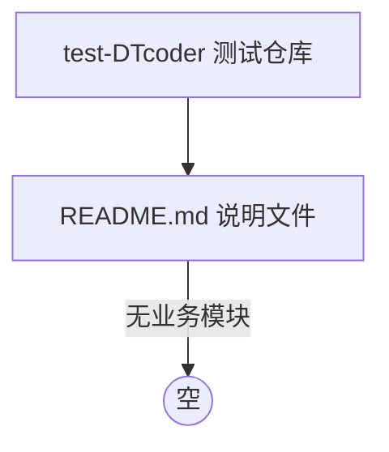

> **文档元信息**
>
> | 项目 | 内容 |
> |------|------|
> | 文档版本 | v1.0 |
> | 作者 | AiWork |
> | 创建日期 | 2026-11-06 |
> | 需求来源 | 任务需求「分析代码结构，功能」（stage=design，节点=系分生成） |
> | 评审状态 | 待评审 |

# 代码结构与功能分析 系分设计

## 0. 分析结论摘要（先行）

本次任务需求为「分析代码结构，功能」，属于**只读类**设计/分析节点。通过对仓库根目录及 Git 元数据的完整扫描，得到如下确定结论：

| 维度 | 结论 |
|------|------|
| 仓库名称 | `test-DTcoder`（测试仓库） |
| 远程地址 | `https://github.com/huanmeng511331/test-DTcoder` |
| 当前分支 | `task/DEV-...`（基于 `origin/main`） |
| Git 已追踪文件 | 仅 `README.md` 一个文件 |
| 源码/模块 | **无**（不存在任何 `.java` / `.ts` / `.py` / 配置文件） |
| 架构/SSOT 文档 | **无**（不存在 `SSOT.md`、`docs/`、`docs/modules/`） |
| 提交历史 | 仅 1 次初始提交 `bbfc7eb Initial commit` |

**核心结论**：这是一个全新的空仓库，除一个说明性 `README.md` 外没有任何业务代码、模块、数据模型或接口。因此「代码结构与功能」事实上为**空集**，本设计文档基于该事实如实呈现，并对后续系统设计给出可落地的基线假设与建议，而非编造不存在的功能。

---

## 1. 需求与范围

### 1.1 背景与目标

- **背景**：任务要求在「系分生成」节点对仓库执行「代码结构，功能」分析。
- **目标**：梳理仓库现有代码结构、模块划分、功能点，作为后续系统设计的基线。
- **实际结果**：仓库为空，无任何可分析的业务代码。

### 1.2 核心功能

当前仓库**无可识别的核心功能**。`README.md` 内容仅为：

```
# test-DTcoder
测试仓库
```

其含义为「测试仓库」，未声明任何业务能力。

### 1.3 约束与非功能要求

当前仓库未声明任何约束或非功能要求。后续若引入真实业务，默认遵循以下基线（假设，理由见 1.5）：

- 后端技术栈默认 Java（数科业务约定），分层采用 Controller–Service–Repository。
- 数据库默认 MySQL（InnoDB，事务隔离级别 ReadCommitted）。
- 部署默认容器化。

### 1.4 排除范围

- 本次不涉及对任何“不存在代码”的功能细化设计。
- 不新建业务模块、表结构、接口（本节点为只读分析节点，且无来源事实支撑）。

### 1.5 需求功能清单与优先级

| 编号 | 功能点 | 优先级 | 原始描述/章节 | 备注 |
|------|--------|--------|-------------------|------|
| F01 | 识别仓库代码结构与功能 | P0 | 任务需求「分析代码结构，功能」 | 已完成：结论为空仓库 |
| — | （无其他功能点） | — | 无来源事实 | 仓库无业务功能，不造需求 |

### 1.6 假设与待确认项

| 编号 | 假设/待确认内容 | 当前假设 | 确认状态 |
|------|-----------------|----------|----------|
| A01 | 目标是否为「分析一个空仓库并为后续开发搭建系分基线」 | 是；仓库当前确为空，本设计文档即基线 | 待确认 |
| A02 | 后续业务系统技术栈 | 默认 Java（数科业务约定） | 待确认 |
| A03 | 是否存在尚未拉取/尚未推送的本地代码 | 否；`git ls-files`、`find`、`git log` 均已核实为空 | 已确认 |
| A04 | SSOT.md / docs 历史资产是否缺失 | 确认为缺失（不存在） | 已确认 |

---

## 2. 架构与模块

### 2.1 功能架构

当前仓库无可填充的功能架构。基于空仓库事实，功能架构为**空**：



### 2.2 模块清单

| 模块 | 职责 | 依赖 |
|------|------|------|
| — | （无任何业务模块） | — |

### 2.3 应用集成架构

当前无集成点。不存在对外/对内服务、数据库、中间件或外部系统调用。

### 2.4 部署架构

当前无部署形态。不存在可部署的应用产物（无构建脚本、无 Dockerfile、无任何源码）。

---

## 3. 数据模型与存储

### 3.1 实体清单

| 实体名称 | 实体说明 | 所属模块 | 与其他实体的关系 |
|----------|----------|----------|-----------------|
| — | （无任何实体，仓库无代码） | — | — |

### 3.2 实体关系图

```mermaid
erDiagram
    % 空仓库，无实体
```

**模型说明**：无实体、无缓存、无 MQ、无存储设计。

---

## 4. 接口设计

当前仓库无任何接口定义。

| 接口类型 | 现状 |
|----------|------|
| oneapi（/api） | 无 |
| OpenAPI（/openapi） | 无 |
| 内部接口（Service） | 无 |
| 集成接口（Integration） | 无 |

---

## 5. 功能模块设计

本仓库无模块，故**无任何表结构、接口或子功能可设计**。此章节如实留空，不生成虚构内容。

---

## 6. 非功能性需求设计

当前无业务系统，本项整体适用性低，仅给出基线说明：

- **6.1 高可用**：不适用，原因：无应用服务。
- **6.2 可扩展性**：不适用，原因：无架构。
- **6.3 稳定性/可靠性**：不适用，原因：无功能流程。
- **6.4 安全性设计**：不适用，原因：无账户体系、无接口、无数据。
- **6.5 监控/统计/日志/告警**：不适用，原因：无运行服务。

---

## 7. 变更三板斧

当前无上线变更需求，三项均「本项不适用」。

- **7.1 可监控**：不适用，原因：无功能点可埋点。
- **7.2 可灰度**：不适用，原因：无新增业务流量。
- **7.3 可应急**：不适用，原因：无上线逻辑需回滚。

---

## 8. 方案检查（Checklist）

| 检查项 | 结论 | 说明 |
|--------|------|------|
| 模块划分合理性 | 不适用 | 无模块 |
| 依赖关系合理性 | 不适用 | 无依赖 |
| 单点问题（部署） | 不适用 | 无部署 |
| 表模型范式 | 不适用 | 无表 |
| 隐私安全 | 不适用 | 无接口/数据 |
| 兼容性（接口） | 不适用 | 无接口 |
| 兼容性（表） | 不适用 | 无表 |
| 数据迁移 | 不适用 | 无表 |
| 一致性（功能点） | 通过 | F01 已在第 1 章落实 |
| 一致性（表） | 通过 | 无实体，无待对账 |
| 一致性（接口） | 通过 | 无接口，无待对账 |
| 一致性（枚举） | 不适用 | 无枚举 |
| 状态机完整性 | 不适用 | 无状态字段实体 |
| 并发风险 | 不适用 | 无功能流程 |
| 单点（定时任务） | 不适用 | 无定时任务 |
| 非功能可行性 | 不适用 | 无功能设计 |
| 三板斧-可监控 | 不适用 | 无埋点 |
| 三板斧-可灰度 | 不适用 | 无灰度 |
| 三板斧-可应急 | 不适用 | 无应急对象 |

---

## 9. 后续建议（供参考，本节点不执行）

若该仓库将被用于承载真实业务，建议下一步：

1. 明确业务领域与技术栈（默认 Java 系，遵循数科编码规范）。
2. 建立 `SSOT.md` / `docs/ARCHITECTURE.md` 资产基线。
3. 在业务需求明确后，再触发「architecture-design / 系分设计」产出具体模块、数据模型与接口设计。
4. 当前「代码结构、功能」分析任务已闭环：结论为空仓库，无代码、无功能。