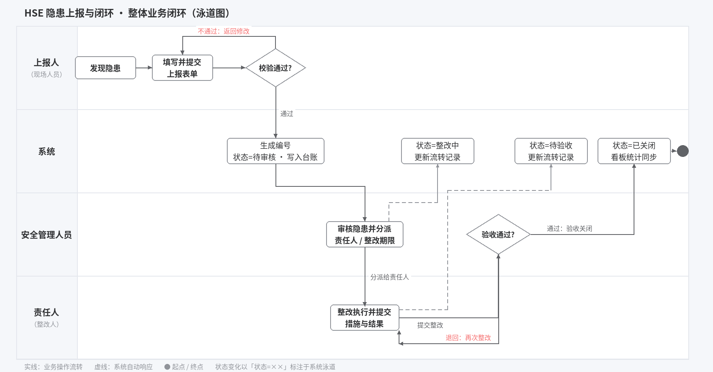
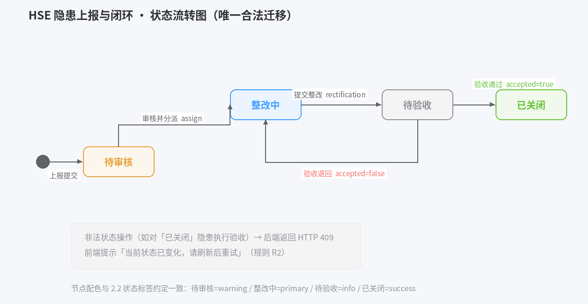
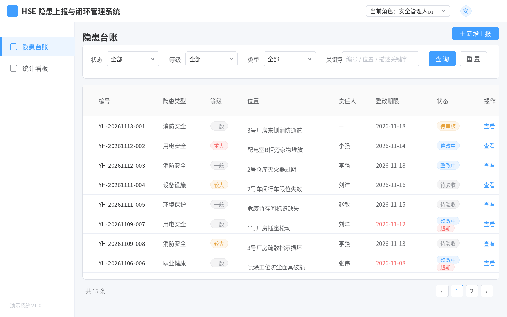
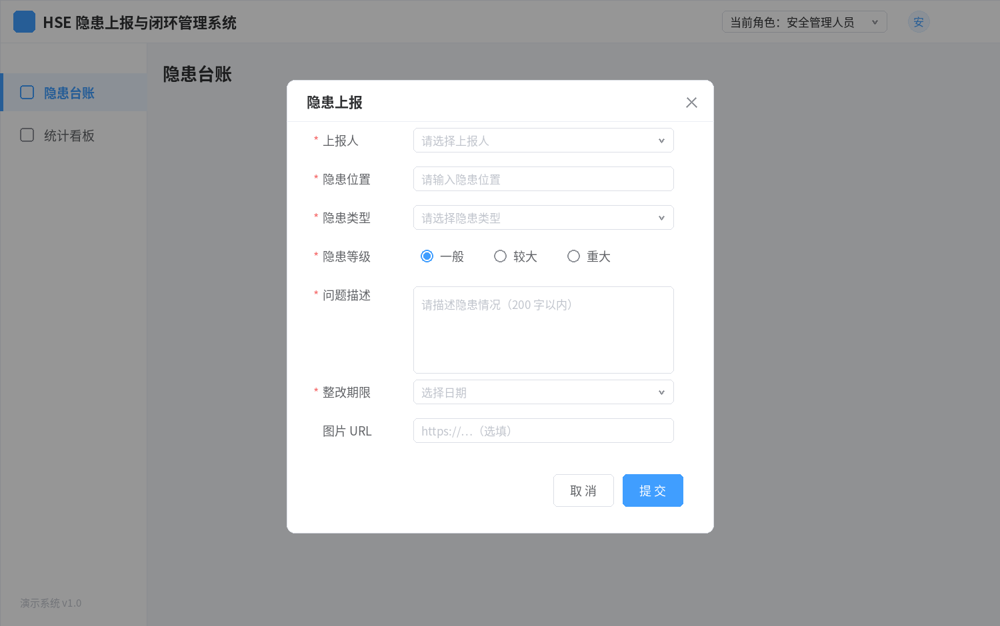
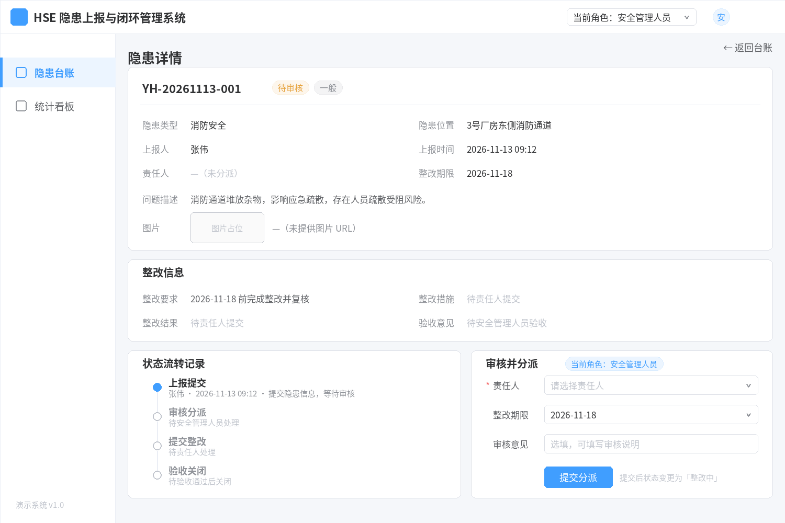
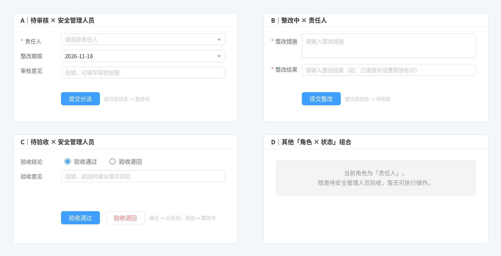
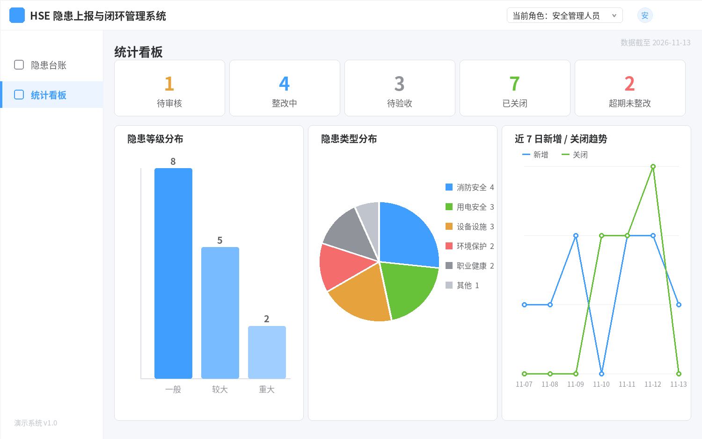

> **文档元信息**
>
> | 项目 | 内容 |
> |------|------|
> | 文档名称 | HSE 隐患上报与闭环 产品需求文档（PRD） |
> | 文档版本 | v1.0 |
> | 作者 | AiWork |
> | 创建日期 | 2026-11-13 |
> | 需求来源 | 任务需求「选题三：HSE 隐患上报与闭环」+《统一技术栈选型》《通用实现要求》（stage=PRD编写，节点=PRD编写） |
> | 视觉基线 | 无输入图件/客户模板；经用户确认采用「Element Plus 风格低保真线框 + 简洁流程图」（灰阶为主、#409EFF 主色点缀、Noto Sans SC 字体），确认记录见《traceability_and_qc.md》 |
> | 评审状态 | 待评审 |

# HSE 隐患上报与闭环 产品需求文档（PRD）

## 修订记录

| 版本 | 日期 | 作者 | 修订说明 |
|------|------|------|----------|
| v1.0 | 2026-11-13 | AiWork | 初稿全量：正文、4 张页面原型、1 张操作区状态变体、2 张流程图、追溯与检查记录 |

## 目录

1. 引言
2. 整体流程与功能概览
3. 功能需求（F1 隐患台账 / F2 隐患上报 / F3 隐患详情与流转处理 / F4 统计看板）
4. 非功能需求与验收
附录A 待确认项
附录B 图件清单

---

## 1 引言

### 1.1 背景与目标

- **背景**：现场人员发现安全、健康或环境（HSE）隐患后，需要通过系统提交隐患位置、类型、描述、等级和整改期限；安全管理人员审核并分派责任人；责任人提交整改措施和完成情况；审核人员确认整改结果后关闭隐患，形成完整业务闭环（来源：需求 6.1）。
- **目标**：交付一套可本机运行的演示系统（Demo），完整支撑「上报隐患 → 审核/分派 → 责任人整改 → 验收确认 → 关闭隐患」最小业务闭环，用于现场培训和演示（来源：需求 6.2、3.1）。
- **成功标准**：需求 6.7 的验收演示四步可依次走通，统计看板能反映每一步的状态变化；通用实现要求（3.1）全部满足。

### 1.2 范围

**本期范围内（In Scope）**

- 隐患台账（多条件筛选列表）、隐患上报（弹窗表单）、隐患详情与状态流转处理（审核分派/提交整改/验收）、统计看板共 4 个业务页面（来源：需求 6.3）。
- 7 个后端 REST API（列表/上报/详情/分派/整改/验收/统计，来源：需求 6.4），数据写入 SQLite 并内置演示初始数据（来源：需求 3.1.5）。
- 技术栈按《统一技术栈选型》执行：Vue 3 + Vite + Element Plus（前端）、FastAPI（后端）、SQLite（存储）、JSON REST API（接口风格）。

**本期范围外（Out of Scope，来源：需求 3.3）**

- 不接入真实中石油生产系统、真实账号或真实敏感数据；演示数据一律使用模拟数据。
- 不部署至服务器或公网；仅本机运行。
- 不实现生产级认证、复杂权限、消息队列或分布式架构；角色以演示方式模拟（见 2.4 R4）。

### 1.3 术语与定义

| 术语 | 定义 |
|------|------|
| HSE | 健康（Health）、安全（Safety）、环境（Environment）管理体系 |
| 隐患 | 现场存在的可能导致事故的不安全状态或不安全行为，本文档中的核心业务对象 |
| 隐患等级 | 隐患的严重程度分类，本 PRD 约定枚举：一般 / 较大 / 重大（待确认项 A1） |
| 隐患类型 | 隐患所属专业分类，本 PRD 约定枚举：消防安全 / 用电安全 / 设备设施 / 环境保护 / 职业健康 / 其他（待确认项 A2） |
| 闭环 | 隐患从上报到关闭的全流程状态受控，每个状态变化均有操作人和记录 |
| 状态流转 | 隐患 `status` 字段在状态机（图 2-2）约束下的迁移 |
| 超期 | 派生展示标签：未关闭隐患的整改期限早于当日（见 2.4 R3） |
| AIWork | 本 PRD 及配套图件的生成/辅助生成工具，生成范围说明见 4.4 |

---

## 2 整体流程与功能概览

### 2.1 业务闭环总览

整体业务闭环涉及「上报人（现场人员）」「安全管理人员」「责任人（整改人）」三类演示角色，系统负责编号生成、状态控制、流转记录与统计。



**图注（图 2-1）**：泳道自上而下为「上报人 / 系统 / 安全管理人员 / 责任人」。主路径为：上报人提交表单 → 系统生成编号、状态置为「待审核」→ 安全管理人员审核并分派（进入「整改中」）→ 责任人提交整改（进入「待验收」）→ 安全管理人员验收：通过则「已关闭」，退回则回到「整改中」由责任人再次整改。两处判定分支：①表单校验不通过返回修改；②验收退回形成整改循环。

### 2.2 状态流转规则

状态机以需求 6.6 为唯一合法迁移依据：



**图注（图 2-2）**：`●` 为流程起点（上报提交），矩形为状态（含演示配色），箭头标注触发操作与对应接口。合法迁移共 4 条；任何不匹配当前状态的操作一律拒绝（规则 R2），前端提示并要求刷新。

**状态与操作表**

| 页面/业务状态 | 可用操作 | 适用角色或条件 | 处理结果/后续状态 |
|---|---|---|---|
| 待审核 | 审核并分派 | 安全管理人员 | 校验通过 → `整改中`，记录责任人、整改期限、审核意见 |
| 整改中 | 提交整改 | 责任人 | 校验通过 → `待验收`，记录整改措施、整改结果 |
| 待验收 | 验收通过 | 安全管理人员 | → `已关闭`，记录验收意见 |
| 待验收 | 验收退回 | 安全管理人员 | → `整改中`，记录退回意见；原整改信息保留（待确认项 A5） |

**状态标签配色约定（Element Plus 语义色）**

| 状态 | 标签类型 | 前景/背景示例 |
|---|---|---|
| 待审核 | warning（橙） | #E6A23C / #FDF6EC |
| 整改中 | primary（蓝） | #409EFF / #ECF5FF |
| 待验收 | info（灰） | #909399 / #F4F4F5 |
| 已关闭 | success（绿） | #67C23A / #F0F9EB |
| 超期（派生标签，可与上述状态并列显示） | danger（红） | #F56C6C / #FEF0F0 |

### 2.3 角色与权限（演示口径）

| 操作 | 上报人（现场人员） | 安全管理人员 | 责任人 |
|---|---|---|---|
| 上报隐患 | ✔ | ✔ | ✔ |
| 审核并分派（待审核） | ✘ | ✔ | ✘ |
| 提交整改（整改中） | ✘ | ✘ | ✔ |
| 验收通过/退回（待验收） | ✘ | ✔ | ✘ |
| 查看台账/详情/看板 | ✔ | ✔ | ✔ |

说明：演示系统不登录（需求 3.3 明确不要求生产级认证），操作资格由顶栏「当前角色」模拟控制，见 2.4 R4。

### 2.4 通用规则（R1–R8）

| 编号 | 规则内容 | 来源/性质 |
|---|---|---|
| R1 | 隐患编号 `hazard_no` 由后端生成，格式 `YH-YYYYMMDD-三位流水`（如 `YH-20261113-001`），当日流水从 001 递增 | 假设（待确认项 A3） |
| R2 | 状态机唯一合法迁移（图 2-2）；对不处于预期状态的隐患执行操作，后端返回 HTTP 409，前端提示「当前状态已变化，请刷新后重试」 | 约定（依据需求 6.6） |
| R3 | 「超期」为派生标签：`status ≠ 已关闭` 且 `due_date < 当日` 时，在台账/详情并列显示红色「超期」标签；不修改 `status`，不阻断操作 | 建议增强（需求 3.2 状态标签） |
| R4 | 无登录演示：顶栏「当前角色」下拉（上报人/安全管理人员/责任人）模拟身份；详情页操作区按「当前角色 + 当前状态」显隐（图 3-4）；上报表单中「上报人」为人员下拉选择 | 约定（依据需求 3.3、6.3.2） |
| R5 | 时间显示 `YYYY-MM-DD HH:mm`；`due_date` 仅日期 `YYYY-MM-DD`，上报当日及以后可选 | 约定 |
| R6 | 台账默认按 `created_at` 倒序，最新上报在前 | 约定 |
| R7 | 图片附件以 URL 形式选填（不做真实文件上传）；详情页以占位缩略框 + 链接文本展示 | 约定（待确认项 A9） |
| R8 | 全部演示数据为模拟数据，人员为「张伟/陈静/王芳/李强/刘洋/赵敏」等虚拟姓名，不得录入真实敏感信息 | 需求 3.3 约束 |

---

## 3 功能需求

### 3.1 F1 隐患台账（列表查询）

**目标与入口**：为安全管理人员及全员提供隐患全景列表，按状态、等级、类型筛选并定位隐患；入口为左侧菜单「隐患台账」，为应用默认首页。前置条件：无。完成结果：用户可查看列表并点击「查看」进入隐患详情页（F3）。

#### 用户流程与处理流程

1. 进入页面 → 前端并发调用 `GET /api/hazards`（默认第 1 页、每页 10 条、`created_at` 倒序）与筛选控件初始值；加载中表格区显示 loading（规则 4.3）。
2. 设置筛选条件（状态/等级/类型/关键字）→ 点击「查询」→ 带 `status/hazard_level/hazard_type/keyword/page=1` 重新请求；点击「重置」清空条件并回到默认列表。
3. 点击「查看」→ 路由跳转 `/hazards/:id`（F3 详情页）。
4. 点击「+ 新增上报」→ 打开上报弹窗（F2）。
5. 无数据时表格区展示空态插画与文案「暂无隐患数据」；请求失败展示错误提示并提供「重试」。
6. 翻页/切换每页条数 → 以当前筛选条件请求对应页。

#### 页面原型



**图注（图 3-1）**：标准管理后台框架（顶栏：系统名 + 当前角色切换；左侧菜单：隐患台账【选中态】/统计看板）。内容区自上而下：页标题与主操作按钮「+ 新增上报」（#409EFF）；筛选卡片（状态下拉、等级下拉、类型下拉、关键字输入、查询/重置）；台账表格（列：编号/隐患类型/等级/位置/责任人/整改期限/状态/操作），状态列使用 2.2 约定色标签，超期记录（如 `YH-20261106-006`，期限 2026-11-08 已过）期限日期显示红色并并列「超期」标签；底部分页「共 15 条」。表内示例数据取自 4.2 演示初始数据（低保真原型示意前 8 条，实际每页 10 条）。

#### 要素说明

**筛选区（要素定义表）**

| 要素名称 | 类型/格式 | 是否必填 | 默认值 | 约束与校验 | 来源或去向 | 备注 |
|---|---|---|---|---|---|---|
| 状态筛选 | 下拉单选：待审核/整改中/待验收/已关闭 | 否 | 全部 | — | → `GET /api/hazards?status=` | 选项含「全部」 |
| 等级筛选 | 下拉单选：一般/较大/重大 | 否 | 全部 | — | → `GET /api/hazards?hazard_level=` | 枚举见 A1 |
| 类型筛选 | 下拉单选：6 类枚举 | 否 | 全部 | — | → `GET /api/hazards?hazard_type=` | 枚举见 A2 |
| 关键字 | 文本输入 | 否 | 空 | 最长 50 字符 | → `keyword`，后端对 `hazard_no/location/description` 模糊匹配 | 防抖 300ms 可选 |
| 查询/重置 | 按钮 | — | — | — | 触发查询/清空条件 | 查询为按钮触发 |

**列表列（展示要素）**

| 要素名称 | 类型/格式 | 来源 | 展示规则 |
|---|---|---|---|
| 编号 `hazard_no` | 文本 | 服务端 | 可读文本，不作链接（详情入口统一为「查看」） |
| 隐患类型 `hazard_type` | 文本 | 服务端 | 枚举文本 |
| 等级 `hazard_level` | 标签 | 服务端 | 一般=info、较大=warning、重大=danger |
| 位置 `location` | 文本（超长省略） | 服务端 | 悬浮提示完整内容 |
| 责任人 `owner` | 文本 | 服务端 | 未分派显示「—」 |
| 整改期限 `due_date` | 日期 | 服务端 | 超期记录按 R3 显示红色 |
| 状态 `status` | 标签 | 服务端 | 按 2.2 配色约定；超期并列红色「超期」标签 |
| 上报时间 `created_at` | 日期时间 | 服务端 | `YYYY-MM-DD HH:mm`（R5） |
| 操作 | 链接按钮 | — | 「查看」→ 详情页 |

**列表接口（GET /api/hazards）**

| 参数 | 类型 | 必填 | 说明 |
|---|---|---|---|
| page / page_size | int | 否 | 默认 1 / 10，`page_size ≤ 50` |
| status | string | 否 | 状态精确匹配 |
| hazard_level | string | 否 | 等级精确匹配 |
| hazard_type | string | 否 | 类型精确匹配 |
| keyword | string | 否 | 对 `hazard_no/location/description` 模糊匹配 |

响应 200（示例）：

```json
{
  "total": 15,
  "page": 1,
  "page_size": 10,
  "items": [
    {
      "id": 1,
      "hazard_no": "YH-20261113-001",
      "hazard_type": "消防安全",
      "hazard_level": "一般",
      "location": "3号厂房东侧消防通道",
      "description": "消防通道堆放杂物，影响应急疏散",
      "reporter": "张伟",
      "owner": null,
      "due_date": "2026-11-18",
      "status": "待审核",
      "rectification_measure": null,
      "rectification_result": null,
      "acceptance_comment": null,
      "image_url": null,
      "overdue": false,
      "created_at": "2026-11-13 09:12:35",
      "updated_at": "2026-11-13 09:12:35"
    }
  ]
}
```

说明：`overdue` 为服务端按 R3 计算的**派生字段**，便于前端渲染超期标签，不落库。

#### 业务规则

| 编号 | 触发操作或条件 | 处理规则 | 用户提示/系统结果 |
|---|---|---|---|
| F1-R1 | 查询成功且无记录 | 表格空态展示 | 「暂无隐患数据」（空态插画） |
| F1-R2 | 任一筛选条件组合查询 | 条件为 AND 关系 | 列表与「共 N 条」同步刷新，页码回到 1 |
| F1-R3 | 请求失败/超时 | 保留当前筛选条件 | 错误提示「加载失败，请稍后重试」+ 重试按钮 |
| F1-R4 | 超期记录渲染 | 前端依据 `overdue` 派生字段 | 期限红显 + 「超期」danger 标签（R3） |

#### 其他专项要求

- 本机环境列表查询响应目标 < 1s（演示口径，非生产 SLA）；分页在服务端完成。

#### 验收标准

1. 默认进入页面可见 15 条初始数据的第一页（10 条）与「共 15 条」，按 `created_at` 倒序。
2. 选择「状态=待审核」查询后，仅显示 `YH-20261113-001`。
3. 选择「等级=重大」查询后，仅显示 `YH-20261112-002`、`YH-20261103-015`。
4. 关键字输入「消防」查询后，返回编号/位置/描述含「消防」的记录（`…001`、`…003`、`…008`、`…012`）。
5. 超期记录（`YH-20261106-006`）的期限显示红色并带「超期」标签；已关闭记录不显示超期标签。
6. 点击任一行「查看」跳转详情页且内容与该记录一致；无数据组合（如状态=待审核+等级=重大）显示空态而非报错。

---

### 3.2 F2 隐患上报（弹窗表单）

**目标与入口**：现场人员发现隐患后提交结构化信息；入口为台账页「+ 新增上报」按钮（弹窗形式，需求 6.3.2 允许「页或弹窗」，本 PRD 约定弹窗）。前置条件：无。完成结果：生成一条「待审核」隐患，台账列表新增首行并弹出成功提示。

#### 用户流程与处理流程

1. 点击「+ 新增上报」→ 打开图 3-2 弹窗，表单初始化（等级默认「一般」，期限默认当日）。
2. 填写：上报人（人员下拉）→ 隐患位置 → 隐患类型 → 隐患等级（单选）→ 问题描述 → 整改期限（日期选择）→ 图片 URL（选填）。
3. 点击「提交」→ 前端校验（必填、长度、期限不早于当日、URL 格式）；不通过则字段下方红字提示并阻断提交（不调用接口）。
4. 校验通过 → `POST /api/hazards`；成功（201）：提示「上报成功」，关闭弹窗，列表刷新且新记录（待审核）出现在最前；失败（4xx/5xx）：提示「上报失败：<原因>」，弹窗保留、已填内容不丢失。
5. 点击「取消」或关闭图标 → 直接关闭弹窗，不保留草稿。

#### 页面原型



**图注（图 3-2）**：台账页之上叠加遮罩层，居中弹窗 640 宽。表单自上而下：上报人（人员下拉）、隐患位置（文本）、隐患类型（下拉）、隐患等级（单选：一般/较大/重大）、问题描述（多行，带字数上限）、整改期限（日期）、图片 URL（选填）。红色「*」标注必填项；底部右侧「取 消」次要按钮 + 「提 交」主按钮（#409EFF）。

#### 要素说明

| 要素名称 | 类型/格式 | 是否必填 | 默认值 | 约束与校验 | 来源或去向 | 备注 |
|---|---|---|---|---|---|---|
| 上报人 `reporter` | 人员下拉（张伟/陈静/王芳/李强/刘洋/赵敏） | 是 | 当前角色对应人（可改） | 必选 | → `reporter` | 模拟人员库（R8） |
| 隐患位置 `location` | 单行文本 | 是 | 空 | 必填，1–50 字符 | → `location` | 示例「3号厂房东侧消防通道」 |
| 隐患类型 `hazard_type` | 下拉单选（6 类） | 是 | 请选择 | 必选 | → `hazard_type` | 枚举见 A2 |
| 隐患等级 `hazard_level` | 单选：一般/较大/重大 | 是 | 一般 | 必选 | → `hazard_level` | 枚举见 A1 |
| 问题描述 `description` | 多行文本 | 是 | 空 | 必填，1–200 字符，实时字数 | → `description` | 需求示例「消防通道堆放杂物，影响应急疏散」 |
| 整改期限 `due_date` | 日期选择 | 是 | 当日 | 不早于当日（R5） | → `due_date` | 需求 6.3.2/6.7 |
| 图片 URL `image_url` | 单行文本 | 否 | 空 | 选填；填写时校验 http(s) 前缀 | → `image_url` | 仅 URL，无上传（R7） |

**上报接口（POST /api/hazards）**：请求体为上表 7 字段；`hazard_no`、`status=待审核`、`id`、`created_at/updated_at` 均由服务端生成。响应 201 返回完整隐患对象；参数校验失败 422；`due_date` 早于当日 400。

#### 业务规则

| 编号 | 触发操作或条件 | 处理规则 | 用户提示/系统结果 |
|---|---|---|---|
| F2-R1 | 任一必填项为空即点提交 | 前端阻断，定位首个错误项 | 字段下方红字「请输入/请选择××」 |
| F2-R2 | 描述超 200 字或位置超 50 字 | 输入即校验，阻断提交 | 「不得超过 N 字」 |
| F2-R3 | 期限早于当日 | 前后端双重校验，阻断 | 「整改期限不能早于今天」 |
| F2-R4 | 提交成功 | 后端生成编号并落库（状态=待审核，R1） | 「上报成功」；弹窗关闭；列表刷新置顶新记录 |
| F2-R5 | 提交失败（网络/服务异常） | 弹窗保留、内容保留 | 「上报失败：<原因>」 |
| F2-R6 | 取消/关闭 | 放弃本次填写 | 弹窗关闭，无副作用 |

#### 其他专项要求

- 提交期间按钮置 loading 防重复提交；同一弹窗内只允许一次在途请求。

#### 验收标准

1. 空表单直接提交：不发起请求，逐字段提示必填。
2. 按需求 6.7 演示口径填写「位置=3号厂房东侧消防通道、类型=消防安全、等级=一般、描述=消防通道堆放杂物，影响应急疏散、上报人=张伟、期限≥当日」提交：提示成功，台账首行出现新「待审核」记录，编号符合 `YH-YYYYMMDD-XXX`。
3. 期限选择昨日：提交被阻断并提示 F2-R3 文案。
4. 填写非法 URL（无 http 前缀）提交：阻断并提示格式错误；留空则可正常提交。
5. 服务端停机时提交：出现失败提示且已填内容不丢失。

---
### 3.3 F3 隐患详情与流转处理

**目标与入口**：查看隐患完整信息与状态流转记录，并按「当前角色 + 当前状态」执行审核分派、提交整改、验收（通过/退回）操作，是业务闭环的核心操作页。入口：台账页「查看」链接，路由 `/hazards/:id`。前置条件：隐患存在；完成结果：状态按图 2-2 流转或仅查看。

#### 用户流程与处理流程

1. 进入页面 → `GET /api/hazards/{id}` 加载隐患详情（含 `flow_records` 流转记录，仅详情接口返回）；加载中显示 loading。
2. 阅读三块信息：基本信息卡（编号/状态标签/等级标签/类型/位置/上报人/上报时间/责任人/整改期限/问题描述/图片）、整改信息区（整改要求与期限、整改措施、整改结果、验收意见）、状态流转记录（时间轴，自上而下为最早→最近）。
3. 操作区按 R4 显隐（详见图 3-4）：
   - 当前状态=待审核 且 当前角色=安全管理人员 → 显示「审核并分派」面板：责任人下拉（必选）、整改期限（默认沿用上报值，可改）、审核意见（选填）→ 点击「提交分派」→ `PATCH /api/hazards/{id}/assign` → 成功后状态变「整改中」，页面提示「分派成功」并刷新。
   - 当前状态=整改中 且 当前角色=责任人 → 显示「提交整改」面板：整改措施（必填）、整改结果（必填）→ `PATCH /api/hazards/{id}/rectification` → 状态变「待验收」。
   - 当前状态=待验收 且 当前角色=安全管理人员 → 显示「验收」面板：验收结论（单选：通过/退回）、验收意见（选填；退回时建议填写）→ 通过：`PATCH /api/hazards/{id}/acceptance`（`accepted=true`）→ 状态「已关闭」；退回（`accepted=false`）→ 状态回「整改中」，责任人可再次提交整改。
   - 其余「角色×状态」组合 → 操作区显示灰色说明文案（如「当前角色为责任人，待安全管理人员验收」），不显示操作按钮。
4. 状态已变化导致操作失败（HTTP 409，规则 R2）→ 提示「当前状态已变化，请刷新后重试」，提供「刷新」按钮。
5. 操作成功后：状态标签、流转记录时间轴、整改信息区同步刷新。

#### 页面原型



**图注（图 3-3）**：以 `YH-20261113-001`（待审核）为例。页面自上而下：①基本信息卡——编号 + 「待审核」橙标签 + 「一般」灰标签，字段栅格（类型/位置/上报人/上报时间/责任人/整改期限）与问题描述多行区、图片占位框；②整改信息区——整改要求（期限 2026-11-18 与描述摘要）、整改措施/整改结果占位（未分派阶段显示「待责任人提交」）、验收意见占位；③状态流转时间轴——已完成节点（上报提交）实色，未完成节点（审核分派/提交整改/验收关闭）灰色；④操作区——当前角色=安全管理人员时的「审核并分派」表单（责任人下拉、整改期限、审核意见）+ 主按钮「提交分派」。



**图注（图 3-4）**：操作区随「状态×角色」变化的四个形态（对应 2.2 状态与操作表）：A 待审核×安全管理人员=审核并分派表单；B 整改中×责任人=提交整改表单（措施+结果）；C 待验收×安全管理人员=验收面板（通过=主按钮进入关闭，退回=次要按钮回到整改中）；D 其他组合=灰色只读说明文案。四个形态共用同一详情页骨架，仅替换操作区。

#### 要素说明

**详情展示要素**

| 要素名称 | 类型/格式 | 来源 | 展示规则 |
|---|---|---|---|
| 编号/状态/等级 | 文本 + 标签 | 服务端 | 状态标签按 2.2 配色；超期并列「超期」标签（R3） |
| 基本信息 | 字段栅格 | 服务端 | 类型/位置/上报人/上报时间/责任人/整改期限/问题描述/图片 URL（R7 占位框） |
| 整改要求 | 文本 | `due_date` + `description` | 「要求 YYYY-MM-DD 前完成整改」 |
| 整改措施 `rectification_measure` | 文本 | 服务端 | 未提交显示占位「待责任人提交」 |
| 整改结果 `rectification_result` | 文本 | 服务端 | 同上；需求 6.7 示例「已清理并设置禁放标识」 |
| 验收意见 `acceptance_comment` | 文本 | 服务端 | 未验收显示占位「待安全管理人员验收」 |
| 状态流转记录 `flow_records` | 时间轴 | 服务端（辅助表） | 每条：时间/动作/操作人/说明；动作枚举：上报提交、审核分派、提交整改、验收通过、验收退回 |

**流转操作接口**

| 接口 | 触发状态→目标状态 | 请求体（必填标 *） | 校验/失败 |
|---|---|---|---|
| `PATCH /api/hazards/{id}/assign` | 待审核→整改中 | `owner*`、`due_date`（缺省沿用上报值）、`comment`、`operator*` | `owner` 为空 400；状态非待审核 409 |
| `PATCH /api/hazards/{id}/rectification` | 整改中→待验收 | `measure*`、`result*`、`operator*` | 任一为空 400；状态非整改中 409 |
| `PATCH /api/hazards/{id}/acceptance` | 待验收→已关闭（`accepted=true`）或→整改中（`false`） | `accepted*`（bool）、`comment`、`operator*` | 状态非待验收 409；退回时保留原整改信息（A5） |

说明：`operator` 取自顶栏「当前角色」对应演示人（R4），写入流转记录；三接口成功均返回更新后的完整隐患对象（含 `flow_records`）。

#### 业务规则

| 编号 | 触发操作或条件 | 处理规则 | 用户提示/系统结果 |
|---|---|---|---|
| F3-R1 | 操作区显隐 | 按「当前角色×当前状态」矩阵（图 3-4）渲染 | 无权限组合仅显示只读说明 |
| F3-R2 | 提交分派成功 | `owner/due_date` 落库，状态→整改中，追加流转记录「审核分派」 | 「分派成功」；状态标签与时间轴刷新 |
| F3-R3 | 提交整改成功 | `measure/result` 落库，状态→待验收，追加「提交整改」 | 「整改提交成功，待验收」 |
| F3-R4 | 验收通过 | 状态→已关闭，`acceptance_comment` 落库，追加「验收通过」 | 「验收通过，隐患已关闭」 |
| F3-R5 | 验收退回 | 状态→整改中，追加「验收退回」，原整改信息保留（A5） | 「已退回整改，请责任人修改后重新提交」 |
| F3-R6 | 409 状态冲突 | 不执行变更 | 「当前状态已变化，请刷新后重试」+ 刷新按钮（R2） |
| F3-R7 | 分派时未改期限 | 沿用上报时的 `due_date` | 期限字段显示当前值（待确认项 A6） |

#### 其他专项要求

- 状态一致性：流转接口在后端事务中校验当前状态并原子更新 `status/updated_at` 与流转记录，避免并发下重复流转（演示口径下以 409 兜底即可）。

#### 验收标准

1. 打开 `YH-20261113-001` 详情：编号、标签、字段与 4.2 种子数据一致；时间轴含「上报提交（张伟）」节点。
2. 切换当前角色=安全管理人员，提交分派（责任人=李强，期限 2026-11-18）→ 状态变「整改中」，时间轴新增「审核分派（安全管理人员）」节点。
3. 切换当前角色=责任人，提交整改（措施=清理通道并复位消防设施，结果=已清理并设置禁放标识）→ 状态「待验收」。
4. 切换回安全管理人员：点击「退回」→ 状态回「整改中」且时间轴新增「验收退回」；再次提交整改后再「通过」→ 状态「已关闭」，验收意见可见。
5. 对已关闭隐患直接调用 `acceptance` 接口（或伪造操作）：返回 409，前端提示刷新文案。
6. 责任人角色在待验收状态下打开详情：操作区仅显示只读说明，无任何操作按钮。

---

### 3.4 F4 统计看板

**目标与入口**：为安全管理人员提供隐患总量、状态分布与构成的可视化总览，支撑验收演示（需求 6.7 第 4 步）。入口：左侧菜单「统计看板」。前置条件：无。完成结果：页面展示统计卡片与三张分布图，数据来自 `GET /api/hazards/statistics`。

#### 用户流程与处理流程

1. 进入页面 → 调用 `GET /api/hazards/statistics`，加载中显示 loading。
2. 渲染：①5 张统计卡片（待审核/整改中/待验收/已关闭/超期未整改）；②等级分布柱状图；③类型分布饼图；④近 7 日新增/关闭趋势折线图（口径见待确认项 A4）。
3. 任何一处状态变化（上报/分派/整改/验收）后重新进入看板 → 数字同步变化。
4. 请求失败 → 显示错误提示与「重试」（卡片与图表区域置空态）。

#### 页面原型



**图注（图 3-5）**：内容区自上而下：①统计卡片行——待审核 1（橙）、整改中 4（蓝）、待验收 3（灰）、已关闭 7（绿）、超期未整改 2（红），与 4.2 种子数据完全一致；②图表行——等级分布柱状图（一般 8/较大 5/重大 2）、类型分布饼图（消防安全 4/用电安全 3/设备设施 3/环境保护 2/职业健康 2/其他 1）、近 7 日趋势折线（新增 9 条、关闭 7 条，逐日数据见 4.2）；图表仅作演示展示，不做钻取交互（建议项，见 4.4）。

#### 要素说明

| 要素名称 | 类型/格式 | 来源 | 展示规则 |
|---|---|---|---|
| 统计卡片 ×5 | 数字卡片 | `statistics.by_status` + `overdue_count` | 数字大号加粗 + 状态标签色；「超期未整改」=`overdue_count`（R3 口径） |
| 等级分布 | 柱状图 | `statistics.by_level` | 三柱，按 一般→较大→重大 排列 |
| 类型分布 | 饼图 | `statistics.by_type` | 图例含类目与数量 |
| 近 7 日趋势 | 折线图（双线） | `statistics.trend` | 两线：新增/关闭；横轴日期 |

**统计接口（GET /api/hazards/statistics）** 响应 200（示例，与 4.2 种子数据一致）：

```json
{
  "total": 15,
  "overdue_count": 2,
  "by_status": {"待审核": 1, "整改中": 4, "待验收": 3, "已关闭": 7},
  "by_level": {"一般": 8, "较大": 5, "重大": 2},
  "by_type": {"消防安全": 4, "用电安全": 3, "设备设施": 3, "环境保护": 2, "职业健康": 2, "其他": 1},
  "trend": [
    {"date": "2026-11-07", "new": 1, "closed": 0},
    {"date": "2026-11-08", "new": 1, "closed": 0},
    {"date": "2026-11-09", "new": 2, "closed": 0},
    {"date": "2026-11-10", "new": 0, "closed": 2},
    {"date": "2026-11-11", "new": 2, "closed": 2},
    {"date": "2026-11-12", "new": 2, "closed": 3},
    {"date": "2026-11-13", "new": 1, "closed": 0}
  ]
}
```

#### 业务规则

| 编号 | 触发操作或条件 | 处理规则 | 用户提示/系统结果 |
|---|---|---|---|
| F4-R1 | 任意状态变化后进入看板 | 统计实时计算（SQLite 聚合查询），不缓存 | 数字与最新台账一致 |
| F4-R2 | 超期统计 | 仅统计 `status≠已关闭` 且 `due_date<当日` | 卡片红色警示 |
| F4-R3 | 请求失败 | 卡片显示「—」+ 图表空态 | 错误提示 + 重试 |

#### 其他专项要求

- 统计查询目标 < 1s（本机演示口径）。

#### 验收标准

1. 初始进入看板：五张卡片显示 1/4/3/7/2，与 4.2 种子数据一致；三张图数字/图例与种子数据一致。
2. 走完 6.7 验收演示链路（上报→分派→整改→验收通过）后回到看板：待审核由 1→2（新增演示隐患）再归零、已关闭 7→8，超期计数相应变化。
3. 近 7 日趋势与种子数据的逐日新增/关闭一致（接口示例为契约）。

---

## 4 非功能需求与验收

### 4.1 运行环境与技术约束（来源：需求 §2）

| 分层 | 技术选型 | 用途 |
|---|---|---|
| 前端框架 | Vue 3 | 页面组件、状态与交互逻辑 |
| 前端工程化 | Vite | 本机开发服务器、热更新与生产构建 |
| 前端组件库 | Element Plus | 表格、表单、按钮、弹窗、菜单、标签、消息提示等 |
| 后端框架 | FastAPI | REST API、请求校验、自动接口文档 |
| 数据库 | SQLite | 本机单文件库（`backend/demo.db`），保存业务数据与演示初始数据 |
| 接口风格 | JSON REST API | 前后端联调与业务操作 |

**本机运行目标**：后端 `uvicorn app.main:app --reload --port 8000`（`backend/` 目录）；前端 `npm install && npm run dev`（`frontend/` 目录）。前端访问 `http://localhost:5173`，接口文档 `http://localhost:8000/docs`。端口可按环境调整，但 README 必须写明最终访问地址与启动命令（需求 2.3）。

**目录结构**按需求 2.2 推荐结构执行（`frontend/src/{api,views,components,router}`、`backend/app/{main,models,schemas,routers,services}`），本 PRD 不另立结构。

### 4.2 数据与演示初始数据（来源：需求 3.1.5、R8）

- 存储：SQLite 单文件 `backend/demo.db`；服务首次启动自动建表并写入种子数据（存在则跳过）。
- 主表 `hazard`：字段按需求 6.5（`id, hazard_no, hazard_type, hazard_level, location, description, reporter, owner, due_date, status, rectification_measure, rectification_result, acceptance_comment, image_url, created_at, updated_at`）。
- 辅助表 `hazard_flow_records`（支撑详情页流转记录）：`id, hazard_id, action, from_status, to_status, operator, comment, created_at`（待确认项 A4 相关）。
- 模拟人员库：张伟、陈静、王芳、李强、刘洋、赵敏。

**种子数据（15 条，统计口径契约）**：

| # | 编号 | 类型 | 等级 | 位置 | 上报人 | 责任人 | 整改期限 | 状态 | 创建日 |
|---|---|---|---|---|---|---|---|---|---|
| 1 | YH-20261113-001 | 消防安全 | 一般 | 3号厂房东侧消防通道 | 张伟 | — | 2026-11-18 | 待审核 | 11-13 |
| 2 | YH-20261112-002 | 用电安全 | 重大 | 配电室B柜旁杂物堆放 | 张伟 | 李强 | 2026-11-14 | 整改中 | 11-12 |
| 3 | YH-20261112-003 | 消防安全 | 一般 | 2号仓库灭火器过期 | 陈静 | 李强 | 2026-11-18 | 整改中 | 11-12 |
| 4 | YH-20261111-004 | 设备设施 | 较大 | 2号车间行车限位失效 | 王芳 | 刘洋 | 2026-11-16 | 待验收 | 11-11 |
| 5 | YH-20261111-005 | 环境保护 | 一般 | 危废暂存间标识缺失 | 陈静 | 赵敏 | 2026-11-15 | 待验收 | 11-11 |
| 6 | YH-20261106-006 | 职业健康 | 一般 | 喷涂工位防尘面具破损 | 王芳 | 张伟 | 2026-11-08 | 整改中（超期） | 11-06 |
| 7 | YH-20261109-007 | 用电安全 | 一般 | 1号厂房插座松动 | 王芳 | 刘洋 | 2026-11-12 | 整改中（超期） | 11-09 |
| 8 | YH-20261109-008 | 消防安全 | 较大 | 3号厂房疏散指示损坏 | 张伟 | 李强 | 2026-11-13 | 待验收 | 11-09 |
| 9 | YH-20261108-009 | 设备设施 | 一般 | 空压机防护罩缺失 | 陈静 | 赵敏 | 2026-11-12 | 已关闭 | 11-08 |
| 10 | YH-20261107-010 | 环境保护 | 较大 | 雨水排口油污 | 张伟 | 赵敏 | 2026-11-11 | 已关闭 | 11-07 |
| 11 | YH-20261106-011 | 职业健康 | 较大 | 打磨工位噪声超标 | 王芳 | 刘洋 | 2026-11-10 | 已关闭 | 11-06 |
| 12 | YH-20261105-012 | 消防安全 | 一般 | 宿舍楼道堆放纸箱 | 陈静 | 张伟 | 2026-11-08 | 已关闭 | 11-05 |
| 13 | YH-20261105-013 | 其他 | 一般 | 围墙西侧照明不足 | 王芳 | 李强 | 2026-11-09 | 已关闭 | 11-05 |
| 14 | YH-20261104-014 | 用电安全 | 较大 | 临时电缆拖地过道 | 张伟 | 刘洋 | 2026-11-07 | 已关闭 | 11-04 |
| 15 | YH-20261103-015 | 设备设施 | 重大 | 起重机钢丝绳断丝 | 王芳 | 赵敏 | 2026-11-06 | 已关闭 | 11-03 |

统计汇总（F4 看板与统计接口契约）：状态 = 待审核 1 / 整改中 4 / 待验收 3 / 已关闭 7；等级 = 一般 8 / 较大 5 / 重大 2；类型 = 消防 4 / 用电 3 / 设备 3 / 环境 2 / 职业 2 / 其他 1；超期未整改 = 2（#6、#7，以演示日 2026-11-13 计）。已关闭各条的 `rectification_measure/result` 与 `acceptance_comment` 按每条隐患主题填充合理的模拟文案。

### 4.3 交互体验要求（来源：需求 3.1.6、3.2）

- **加载**：列表/详情/看板首屏与操作提交均有 loading 反馈（Element `v-loading`/按钮 loading）。
- **空数据**：列表与图表空态使用 `el-empty` 文案「暂无隐患数据 / 暂无统计数据」。
- **结果提示**：成功用 `ElMessage.success`，失败用 `ElMessage.error`，文案见各功能业务规则表。
- **表单校验**：必填、长度、日期下限、URL 格式逐字段校验（F2/F3 要素定义表）。
- **建议项（尽力实现）**：分页筛选排序已含（F1）；状态标签已含（2.2）；页面或 README 说明 AIWork 生成/辅助生成内容与人工调整（见 4.4）。

### 4.4 交付与说明要求（来源：需求 3.1.7、3.2.4）

- **README.md（必交）**：说明项目用途、环境要求（Node/Python 版本）、安装步骤、前后端启动命令、最终访问地址（前端 5173 / 接口文档 8000 / 端口调整说明）、演示路径（对应 4.5 验收演示）、演示数据与角色说明。
- **AIWork 生成说明**：README 或页面「关于」中说明哪些内容由 AIWork 生成/辅助生成（PRD、原型、流程图、前后端脚手架等）、人工做了哪些调整。

### 4.5 全局验收标准（含验收演示路径）

**通用实现要求逐条验收（来源：需求 3.1）**

| # | 要求 | 验收方式 |
|---|---|---|
| 1 | 页面本机可访问、无明显报错 | 按 4.1 启动前后端，浏览器访问 5173，控制台无未处理报错 |
| 2 | ≥3 个业务页面/视图 | 本 PRD 4 个页面（台账/上报弹窗/详情/看板） |
| 3 | ≥3 个真实可调用后端 API | 本 PRD 7 个接口（需求 6.4 全量），数据真实落库 SQLite，无全静态假数据 |
| 4 | 完整业务链路 | 下方验收演示四步走通 |
| 5 | SQLite + 初始数据 | `backend/demo.db` 存在，15 条种子数据符合 4.2 契约 |
| 6 | 加载/空态/提示/校验 | 按 4.3 逐项抽查 |
| 7 | README 完整 | 按 4.4 逐项抽查 |

**验收演示路径（来源：需求 6.7，主链路回归用例）**

| 步骤 | 操作 | 预期结果 |
|---|---|---|
| 1 | 上报人角色：新增上报「消防通道堆放杂物」一般隐患（位置 3号厂房东侧消防通道，期限≥当日） | 提示成功；台账/详情出现新「待审核」记录；看板待审核 +1 |
| 2 | 安全管理人员角色：详情页审核并分派责任人（如李强），设置整改期限 | 状态→「整改中」；时间轴新增「审核分派」；看板整改中 +1、待审核 −1 |
| 3 | 责任人角色：详情页提交整改（措施+结果「已清理并设置禁放标识」） | 状态→「待验收」；时间轴新增「提交整改」 |
| 4 | 安全管理人员角色：验收通过并关闭；回到统计看板 | 状态→「已关闭」；看板已关闭 +1、待验收 −1，等级/类型分布同步 |

---

## 附录A 待确认项

| 编号 | 事项 | 本 PRD 采用的默认口径 | 影响 | 状态 |
|---|---|---|---|---|
| A1 | 隐患等级枚举 | 一般 / 较大 / 重大 | 影响筛选选项、标签与统计分布 | 待确认（需求未给全枚举） |
| A2 | 隐患类型枚举 | 消防安全/用电安全/设备设施/环境保护/职业健康/其他 | 同上 | 待确认 |
| A3 | 隐患编号规则 | `YH-YYYYMMDD-三位流水`，后端生成 | 影响台账展示与搜索 | 假设 |
| A4 | 流转记录存储与趋势口径 | 新增辅助表 `hazard_flow_records`；趋势「关闭」按验收通过时间聚合 | 影响详情时间轴与看板趋势 | 建议 |
| A5 | 验收退回后的整改信息处理 | 保留原整改措施/结果，追加退回记录 | 影响退回后详情展示 | 约定（可调整） |
| A6 | 分派时整改期限是否可改 | 可改，缺省沿用上报值 | 影响分派表单 | 约定（可调整） |
| A7 | 是否需要真实登录/权限 | 不需要，顶栏角色切换模拟 | 影响整体交互（需求 3.3 支持此口径） | 假设 |
| A8 | 接口响应包裹结构 | 直接返回资源 JSON + HTTP 状态码（FastAPI 惯例），错误用 `detail` | 影响前后端联调约定 | 约定 |
| A9 | 图片附件形式 | 仅 URL 选填，不实现上传 | 影响 F2 表单与详情展示（R7） | 约定 |

## 附录B 图件清单

| 图号 | 名称 | 文件（assets/） | 用途 | 样式基线 |
|---|---|---|---|---|
| 图 2-1 | 整体业务闭环泳道图 | flow_business_loop.png | 表达多角色职责与闭环主/支路径 | 用户确认：Element Plus 风格低保真 + 简洁流程图（2026-11-13 对话确认） |
| 图 2-2 | 隐患状态流转图 | flow_state.png | 状态机唯一合法迁移（需求 6.6） | 同上 |
| 图 3-1 | 隐患台账页原型 | proto_hazard_list.png | F1 页面可见原型 | 同上 |
| 图 3-2 | 隐患上报弹窗原型 | proto_report_dialog.png | F2 页面可见原型 | 同上 |
| 图 3-3 | 隐患详情页原型（待审核） | proto_detail.png | F3 页面可见原型 | 同上 |
| 图 3-4 | 详情页操作区各状态形态 | proto_detail_actions.png | F3 状态相关操作区补图 | 同上 |
| 图 3-5 | 统计看板页原型 | proto_dashboard.png | F4 页面可见原型 | 同上 |

*本 PRD 与图件由 AiWork 生成（v1.0，2026-11-13），评审通过前不属于已确认需求；依据、追溯与质量检查记录见同目录《traceability_and_qc.md》。*
