> **文档元信息**
>
> | 项目 | 内容 |
> |------|------|
> | 文档名称 | HSE 隐患上报与闭环 系分设计 |
> | 文档版本 | v1.0 |
> | 作者 | AiWork |
> | 创建日期 | 2026-11-13 |
> | 需求来源 | .agents/20261113-HSE隐患上报与闭环/PRD.md（v1.0，2026-11-13）+ 任务需求《统一技术栈选型》《通用实现要求》《选题三：HSE 隐患上报与闭环》 |
> | 评审状态 | 待评审 |

# HSE 隐患上报与闭环 系分设计

## 0. 复杂度路由

| 路由结论 | 命中条件/判定依据 | 执行范围 | 决策记录位置 |
|----------|-----------------|----------|--------------|
| 完整流程 | 状态流转变化（隐患状态机 4 条合法迁移）+ 新增数据模型与初始化数据（2 表+15 条种子）+ 跨页面多模块（前端 4 页面、后端 3 模块） | Step 0–9 全量执行 | docs/temp/.draft/202611130930-k3m/decisions.md |

流程实例：202611130930-k3m。需求→设计追溯基于 PRD 功能编号 F1–F4 与需求 §2/§3/§6，设计功能点编号 F01–F14。

## 1. 需求与范围

### 1.1 背景与目标

- **背景**：现场人员发现安全、健康或环境（HSE）隐患后，需要通过系统提交隐患位置、类型、描述、等级和整改期限；安全管理人员审核并分派责任人；责任人提交整改措施和完成情况；审核人员确认整改结果后关闭隐患，形成完整业务闭环（PRD 1.1，需求 6.1）。
- **目标**：交付一套本机可运行的演示系统（Demo），完整支撑「上报隐患 → 审核/分派 → 责任人整改 → 验收确认 → 关闭隐患」最小业务闭环，用于现场培训和演示（需求 6.2、3.1）。
- **成功标准**：需求 6.7 验收演示四步（上报→分派→整改→验收关闭）可依次走通，统计看板同步反映每步状态变化；《通用实现要求》3.1 七项全部满足（PRD 4.5 全局验收标准）。

### 1.2 核心功能

1. 隐患台账页：分页列表 + 状态/等级/类型/关键字筛选（PRD F1）。
2. 隐患上报弹窗：结构化表单 + 前后端双重校验，生成「待审核」隐患并自动编号（PRD F2）。
3. 隐患详情页：基本信息 + 整改信息 + 状态流转时间轴，按「角色×状态」提供审核分派/提交整改/验收（通过/退回）操作（PRD F3）。
4. 统计看板页：状态计数卡片 + 等级/类型分布 + 近 7 日新增/关闭趋势（PRD F4）。
5. 数据持久化：SQLite 单文件，服务首次启动自动建表并写入 15 条演示种子数据（PRD 4.2 契约）。
6. 演示角色机制：顶栏「当前角色」切换（上报人/安全管理人员/责任人）模拟操作资格，无登录（PRD 2.3/2.4 R4）。

### 1.3 约束与非功能要求

| 类别 | 约束 | 来源 |
|---|---|---|
| 技术栈 | Vue 3 + Vite + Element Plus；FastAPI；SQLite；JSON REST API | 需求 §2 |
| 运行形态 | 本机运行：前端 5173、后端 8000；README 写明最终访问地址与启动命令 | 需求 2.3 |
| 目录结构 | 按需求 2.2 推荐结构执行（frontend/src/{api,views,components,router}、backend/app/{main,models,schemas,routers,services}） | 需求 2.2、PRD 4.1 |
| 数据 | 演示数据一律模拟（虚拟姓名），不得录入真实敏感信息 | 需求 3.3、PRD R8 |
| 性能 | 列表/统计查询本机响应 <1s（演示口径，非生产 SLA） | PRD F1/F4 专项要求 |
| 体验 | 加载、空数据、提交成功/失败提示、表单校验逐项落实 | 需求 3.1.6、PRD 4.3 |
| 状态机 | 需求 6.6 四条合法迁移为唯一依据，非法操作返回 409 | PRD R2 |
| 交付 | README 必交，并说明 AIWork 生成/辅助生成范围与人工调整 | 需求 3.1.7、3.2.4、PRD 4.4 |

### 1.4 排除范围

不接入真实中石油生产系统、真实账号或真实敏感数据；不部署至服务器或公网；不实现生产级认证、复杂权限、消息队列或分布式架构（需求 3.3）。

### 1.5 需求功能清单与优先级

| 编号 | 功能点 | 优先级 | PRD 原始描述/章节 | 备注 |
|---|---|---|---|---|
| F01 | 隐患台账分页列表查询 | P0 | PRD 3.1（需求 6.3.1） | 默认 created_at 倒序（R6），服务端分页 |
| F02 | 台账多条件筛选（状态/等级/类型/关键字） | P0 | PRD 3.1（需求 6.3.1） | 条件 AND；关键字模糊匹配编号/位置/描述 |
| F03 | 隐患上报（弹窗表单+校验+编号生成） | P0 | PRD 3.2（需求 6.3.2、6.7） | 弹窗形式；hazard_no 后端生成（R1） |
| F04 | 隐患详情查询 | P0 | PRD 3.3（需求 6.3.3） | 含全部字段与派生 overdue |
| F05 | 审核并分派（待审核→整改中） | P0 | PRD 3.3（需求 6.3.3、6.6） | owner 必填；期限缺省沿用上报值（A6） |
| F06 | 提交整改（整改中→待验收） | P0 | PRD 3.3（需求 6.3.3、6.6） | 措施/结果必填 |
| F07 | 验收通过/退回（待验收→已关闭/整改中） | P0 | PRD 3.3（需求 6.3.3、6.6） | 退回保留原整改信息（A5） |
| F08 | 统计看板（状态计数+等级/类型分布+近7日趋势） | P0 | PRD 3.4（需求 6.3.4） | 与 PRD 4.2 种子数据契约一致 |
| F09 | 状态流转记录时间轴 | P0 | PRD 3.3 要素表（A4 辅助表） | 仅详情接口返回 |
| F10 | 演示角色切换与操作区显隐 | P0 | PRD 2.3、2.4 R4 | 前端逻辑；operator 随流转接口提交 |
| F11 | 演示初始数据与自动建库 | P0 | 需求 3.1.5、PRD 4.2 | 首次启动建表+15 条种子，幂等 |
| F12 | 超期派生标签与超期统计 | P1 | PRD 2.4 R3、3.4 F4-R2（需求 3.2 建议） | 不修改 status，不落库 |
| F13 | 交互体验（加载/空态/提示/校验） | P0 | 需求 3.1.6、PRD 4.3 | 前端组件行为 + 后端入参校验 |
| F14 | README 交付（用途/环境/步骤/启动/演示路径/AIWork 说明） | P0 | 需求 3.1.7、3.2.4、PRD 4.4 | 文档交付项，无运行时接口 |

### 1.6 假设与待确认项

| 编号 | 假设/待确认内容 | 当前假设 | 确认状态 |
|---|---|---|---|
| A01 | 隐患等级枚举 | 一般/较大/重大 | 待确认（PRD 附录A A1，已按默认口径执行） |
| A02 | 隐患类型枚举 | 消防安全/用电安全/设备设施/环境保护/职业健康/其他 | 待确认（PRD 附录A A2，已按默认口径执行） |
| A03 | 编号规则 YH-YYYYMMDD-三位流水，后端生成 | 采用 | 已确认（PRD R1 假设口径） |
| A04 | 流转记录辅助表；趋势「关闭」按验收通过时间聚合 | 采用 | 已确认（PRD A4 建议口径） |
| A05 | 验收退回保留原整改措施/结果 | 采用 | 已确认（PRD A5） |
| A06 | 分派时整改期限可改，缺省沿用上报值 | 采用 | 已确认（PRD A6） |
| A07 | 无真实登录，顶栏角色模拟 | 采用 | 已确认（PRD A7，需求 3.3 支持） |
| A08 | 响应为资源 JSON + HTTP 状态码，错误用 detail | 采用 | 已确认（PRD A8） |
| A09 | 图片仅 URL 选填，不实现上传 | 采用 | 已确认（PRD A9/R7） |

说明：A01/A02 枚举已在 PRD 给出默认口径，台账筛选、状态标签、统计契约均按其落定；按「连续推进」原则直接采用。若业务评审调整枚举，仅影响枚举常量与种子数据，不改变本设计的结构与状态机。

## 2. 架构与模块

### 2.1 功能架构

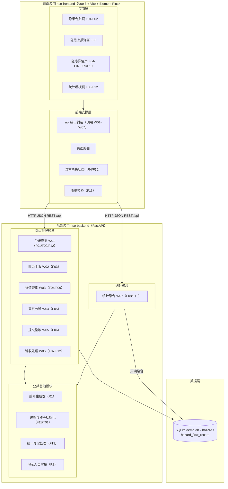

层级说明：

- **前端页面层**：台账/详情/看板 3 个页面视图 + 上报弹窗组件，承担 F10 角色显隐与 F13 交互体验；图表采用 ECharts（Element Plus 无图表组件，需求 6.3.4 要求柱状/饼/折线图）。
- **前端支撑层**：api 封装（唯一后端调用出口）、路由（`/` 台账默认首页、`/hazards/:id` 详情、`/dashboard` 看板）、当前角色状态、表单校验。
- **公共基础模块**：编号生成（R1）、启动建库与种子（F11/T01）、统一异常处理（F13 错误响应支撑）、演示人员常量（R8）。
- **隐患管理模块**：隐患查询/上报/详情与三个流转操作及流转记录，业务闭环核心。
- **统计模块**：只读聚合（状态/等级/类型计数、超期数、近 7 日趋势），无写操作。

**模块清单**

| 模块 | 职责说明 | 包含的功能点 | 依赖的模块 |
|---|---|---|---|
| 前端·页面层（hse-frontend views） | 台账/详情/看板页面渲染与交互，上报弹窗 | F01、F02、F03、F04、F05、F06、F07、F08、F09、F10、F12、F13 | 前端·支撑层 |
| 前端·支撑层（hse-frontend api/router/store） | 接口封装、路由、当前角色状态、表单校验 | F10、F13（支撑） | 无 |
| 后端·公共基础模块 | 编号生成、启动建库与种子初始化、统一异常处理、演示人员常量 | F11、F03（编号支撑）、F13（异常响应支撑） | 无 |
| 后端·隐患管理模块 | 隐患全生命周期数据管理与状态流转控制 | F01–F07、F09、F12、F13（入参校验） | 公共基础模块 |
| 后端·统计模块 | 隐患统计聚合查询（只读） | F08、F12 | 公共基础模块（读 hazard 表仓储） |

依赖关系为单向无环：页面层→支撑层→后端业务模块→公共基础；隐患管理与统计互不依赖（统计仅只读 hazard 表），无循环依赖。

### 2.2 应用集成架构

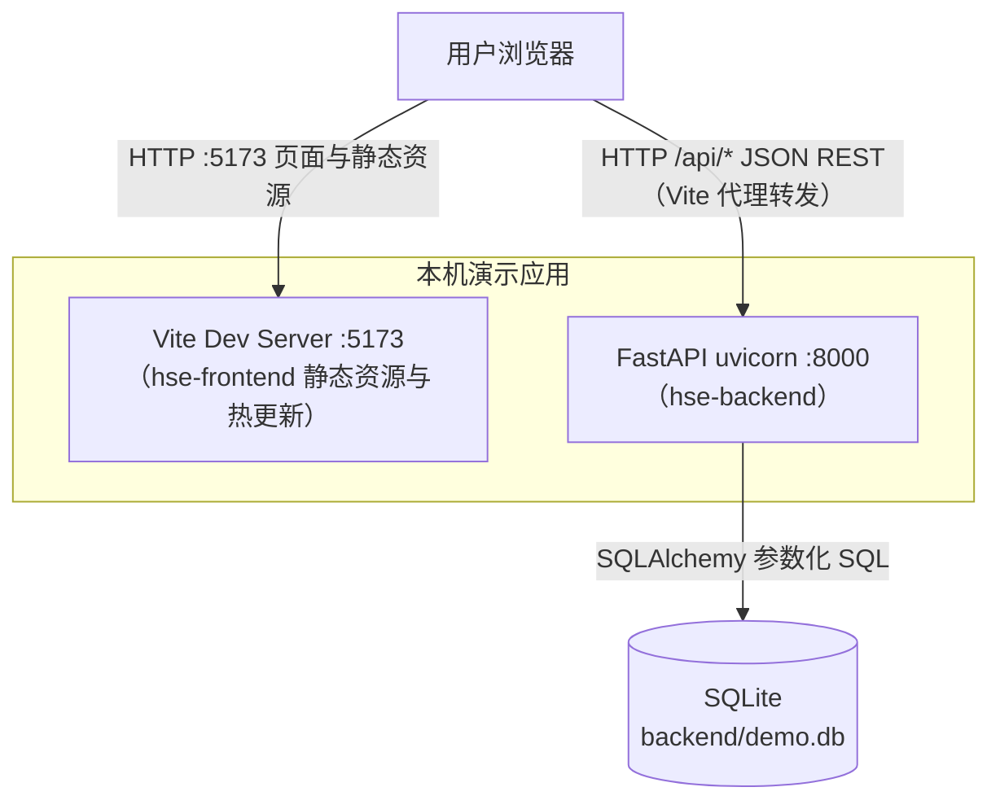

**集成关系说明**

| 调用方 | 被调用方 | 协议 | 接口类型 | 说明 |
|---|---|---|---|---|
| 用户浏览器 | hse-frontend（Vite :5173） | HTTP | 页面/静态资源 | 开发服务器托管页面（需求 2.3） |
| 用户浏览器 | hse-backend（:8000） | HTTP | oneapi REST（W01–W07） | 经 Vite 代理 /api → 8000 规避跨域；后端另启用 CORS 中间件兜底 |
| hse-backend | SQLite demo.db | 文件级 SQL | 仓储层 | SQLAlchemy 参数化访问，单文件随项目目录 |

外部系统集成：**本项不适用，原因：演示系统不接入任何外部系统（需求 3.3），无 OpenAPI/集成接口。**

### 2.3 部署架构

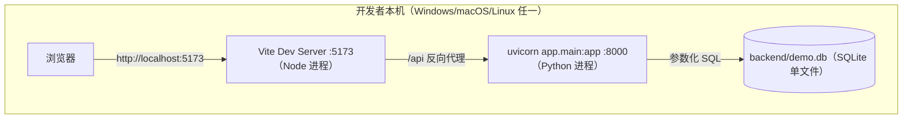

**部署说明**

- 单机单实例双进程：Node（前端）+ Python（后端）；启动命令按需求 2.3（`npm run dev` / `uvicorn app.main:app --reload --port 8000`），端口可调并以 README 记录的最终地址为准。
- 数据层为 SQLite 单文件 demo.db，随项目目录存放；删除文件重启即可恢复种子初始态。
- 单点说明：本机演示形态允许单点（需求 3.3 明确排除服务器部署与高可用要求），不构成设计缺陷；未来转生产需替换集中式数据库并增加实例冗余（见第 5 章 NFR-04）。

## 3. 数据模型与存储

### 3.1 实体清单

| 实体名称 | 实体说明 | 所属模块 | 与其他实体的关系 |
|---|---|---|---|
| hazard（隐患） | 闭环核心业务对象：编号、类型、等级、位置、描述、上报/责任人、期限、状态及整改/验收信息 | 后端·隐患管理模块 | 一对多关联 hazard_flow_record |
| hazard_flow_record（隐患流转记录） | 每次状态动作（上报提交/审核分派/提交整改/验收通过/验收退回）的操作人、前后状态与意见，支撑详情时间轴与「关闭」趋势统计 | 后端·隐患管理模块 | 多对一关联 hazard |

说明：

- 统计模块不新增实体，仅对 hazard / hazard_flow_record 做只读聚合。
- 公共基础模块无落库实体：演示人员库（张伟/陈静/王芳/李强/刘洋/赵敏，R8）为前后端代码常量，不建表（避免过度设计，见决策文件 Step 3）。

### 3.2 实体关系图

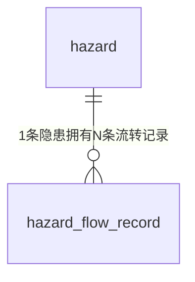

### 3.3 模型说明

1. 关联完整性由服务层维护：references/db.md 禁止使用外键约束，hazard_flow_record.hazard_id 为逻辑关联，应用层保证写入前 hazard 存在；hazard_id 建普通索引保障按隐患查询流转记录。
2. 租户隔离：**本项不适用，原因：单机演示、无多租户诉求（需求 3.3），不设计 tenant 字段。**
3. 缓存/MQ：不引入。数据量小（种子 15 条 + 演示增量），且 F4-R1 要求统计实时计算不缓存，SQLite 直查即可满足 <1s 目标。
4. 命名与类型遵循 references/db.md 并做 SQLite 适配：表名小写单数且 ≤26 字符（hazard_flow_record 共 18 字符）；整形单列自增主键；不使用外键/触发器/视图；不使用 enum 列类型（状态/类型/等级以 TEXT + 应用层枚举常量约束）；时间字段以 TEXT 存 ISO-8601（SQLite 无 datetime 类型，db.md「禁 timestamp」的意图由应用层统一格式满足）；布尔语义派生字段（overdue）不落库。
5. 字段级表结构定义在第 4 章 4.4 隐患管理模块给出。

## 4. 功能模块与接口设计

### 4.1 模块—接口映射

接口分类说明：

- **oneapi（前端接口）**：全部 7 个 HTTP 接口，路径前缀 /api，与需求 6.4 完全一致。
- **对外 OpenAPI**：本项不适用，原因：无外部系统调用方（需求 3.3）。
- **内部接口**：本项不适用，原因：单体应用，无跨服务/跨应用调用。
- **集成接口**：本项不适用，原因：无外部系统依赖。
- **任务接口**：启动初始化任务 T01（建库与种子，无 HTTP 入口）。

| 接口编号 | 接口名称 | 类型 | 方法/触发方式 | 路径/方法签名 | 所属模块 | 对应功能点 |
|---|---|---|---|---|---|---|
| W01 | 隐患列表查询 | oneapi | GET | /api/hazards | 隐患管理 | F01、F02、F12 |
| W02 | 隐患上报 | oneapi | POST | /api/hazards | 隐患管理 | F03、F13 |
| W03 | 隐患详情查询 | oneapi | GET | /api/hazards/{id} | 隐患管理 | F04、F09、F12 |
| W04 | 审核并分派 | oneapi | PATCH | /api/hazards/{id}/assign | 隐患管理 | F05、F10、F13 |
| W05 | 提交整改 | oneapi | PATCH | /api/hazards/{id}/rectification | 隐患管理 | F06、F10、F13 |
| W06 | 验收并关闭/退回 | oneapi | PATCH | /api/hazards/{id}/acceptance | 隐患管理 | F07、F10、F12、F13 |
| W07 | 隐患统计查询 | oneapi | GET | /api/hazards/statistics | 统计 | F08、F12 |
| T01 | 启动建库与种子初始化 | 任务 | 应用启动钩子（FastAPI lifespan） | hse-backend.StartupInitializer.initialize() | 公共基础 | F11 |

功能点覆盖说明：

| 功能点 | 落点 |
|---|---|
| F01/F02 | W01 |
| F03 | W02（编号生成由公共基础 IdGenerator 支撑） |
| F04/F09 | W03 |
| F05/F06/F07 | W04/W05/W06 |
| F08 | W07 |
| F10 | 前端页面逻辑（角色×状态显隐，见 2.1/4.2.3）；operator 经 W04/W05/W06 入参提交并落流转记录 |
| F11 | T01 |
| F12 | W01/W03/W07 的 overdue 派生计算与超期统计 |
| F13 | 前端表单校验与组件反馈（2.1/4.2.3）+ W02/W04/W05/W06 服务端入参校验 |
| F14 | 文档交付项（README），无运行时接口，交付要求见需求 3.1.7 与 PRD 4.4 |

### 4.2 全局约定

#### 4.2.1 接口与数据约定

| 约定项 | 约定内容 | 依据 |
|---|---|---|
| 出参结构 | 成功直接返回资源 JSON（对象，或列表包装 {total,page,page_size,items}），不使用 {result,msg,data} 包裹 | PRD A8 |
| 错误结构 | HTTP 状态码（400/404/409/422/500）+ body {"detail": "中文提示"}；状态冲突固定 409 | PRD A8、R2 |
| 分页 | page（默认 1）/page_size（默认 10，上限 50）；服务端分页；默认排序 created_at 倒序、id 倒序（稳定序） | PRD F1 要素表、R6 |
| 时间格式 | created_at/updated_at 存储与返回 "YYYY-MM-DD HH:mm:ss"；due_date 为 "YYYY-MM-DD"；前端展示按 R5（YYYY-MM-DD HH:mm） | R5 |
| 当日口径 | 「今日」取服务端本地日期（本机演示，无时区歧义） | R3/R5 |
| 编号规则 | YH-YYYYMMDD-三位流水（001 起当日递增），后端生成，唯一索引兜底 | R1/A03 |
| 派生字段 | overdue（bool）由服务端按「status≠已关闭 且 due_date<今日」计算，不落库 | R3/F12 |
| 数据访问 | SQLAlchemy 声明式模型 + 参数化 SQL；流转操作单事务；状态流转用「状态守卫更新」保证原子性 | 决策 Step 5 |
| 归属应用名 | 后端 hse-backend（FastAPI 应用）；前端 hse-frontend（时序图调用方） | 时序图规范 |

#### 4.2.2 模块映射表

模块→功能点：

| 模块 | 功能点 |
|---|---|
| 公共基础 | F11、F03（编号支撑）、F13（异常响应支撑） |
| 隐患管理 | F01、F02、F03、F04、F05、F06、F07、F09、F10（配合）、F12、F13（校验支撑） |
| 统计 | F08、F12 |

模块→实体：

| 模块 | 实体 |
|---|---|
| 公共基础 | 无（种子写入复用隐患管理的 hazard/hazard_flow_record 仓储） |
| 隐患管理 | hazard、hazard_flow_record |
| 统计 | 无专属实体（只读 hazard / hazard_flow_record） |

模块→接口：

| 模块 | 接口 |
|---|---|
| 公共基础 | T01 |
| 隐患管理 | W01、W02、W03、W04、W05、W06 |
| 统计 | W07 |

#### 4.2.3 前端模块设计要点

| 前端单元 | 职责 | 依赖接口 | 对应功能点 |
|---|---|---|---|
| views/HazardListView | 台账表格、筛选卡片、分页、空态/错误重试 | W01 | F01/F02/F12/F13 |
| components/ReportDialog | 上报弹窗表单与校验（必填/长度/期限下限/URL 格式/提交 loading 防重复） | W02 | F03/F13 |
| views/HazardDetailView | 详情三块信息、流转时间轴、按「角色×状态」显隐的操作面板（图 3-4 四形态） | W03/W04/W05/W06 | F04–F07/F09/F10/F13 |
| views/DashboardView | 统计卡片×5 与三张图表（ECharts 柱状/饼/折线） | W07 | F08/F12/F13 |
| router | /（台账默认首页）、/hazards/:id、/dashboard | — | F10 |
| api/hazard.js | W01–W07 统一封装、409/4xx/5xx 错误提示文案 | 全部 | F13 |

说明：前端页面交互细节（要素定义表、业务规则 F*-R*、验收标准）以 PRD 3.1–3.4 为准，本系分不重复展开；后端接口契约与 PRD 完全对齐。

#### 4.2.4 模块设计顺序

公共基础（被依赖：建表/编号/异常/人员常量）→ 隐患管理（核心实体与状态机）→ 统计（只读聚合，依赖表结构已定）。

模块级进度追踪：

- [x] 公共基础模块（4.3）
- [x] 隐患管理模块（4.4）
- [x] 统计模块（4.5）

### 4.3 公共基础模块

**模块职责**：为业务模块提供编号生成、启动建库与演示种子数据初始化、统一异常处理与演示人员常量。
**覆盖功能点**：F11（主）、F03（编号生成支撑）、F13（异常响应支撑）。
**依赖模块/接口**：无（最底层模块）。

#### 4.3.1 表结构设计

本模块无专属表结构，原因：种子数据写入隐患管理模块的 hazard / hazard_flow_record 表（见 4.4.1）；演示人员库为 6 个固定虚拟姓名的代码常量（R8），无管理界面与变更需求，落库无收益。

#### 4.3.2 枚举与常量定义

| 名称 | 取值 | 含义 | 关联字段/用途 |
|---|---|---|---|
| DemoPerson | 张伟/陈静/王芳/李强/刘洋/赵敏 | 模拟人员库（上报人下拉、责任人下拉、角色演示人） | hazard.reporter / hazard.owner / 流转 operator（R8） |
| 编号规则 | YH-YYYYMMDD-NNN（NNN=001 起当日递增，三位补零） | 隐患编号生成规则（R1/A03） | hazard.hazard_no |

#### 4.3.3 仓储层设计

本模块不独立定义仓储类，原因：无专属持久化实体；建表与种子写入复用 4.4.2 定义的 HazardRepository.create_tables() / count_seed() / insert_seed()（来源：隐患管理模块仓储），编号流水查询复用 HazardRepository.max_seq_by_prefix()。

#### 4.3.4 接口设计

| 接口编号 | 接口名称 | 类型 | 方法/触发方式 | 路径/方法签名 | 对应功能点 |
|---|---|---|---|---|---|
| T01 | 启动建库与种子初始化 | 任务 | FastAPI lifespan 启动钩子 | hse-backend.StartupInitializer.initialize() | F11 |

##### 4.3.4.1 T01 启动建库与种子初始化（F11）

- **类型**：任务（内部启动钩子，无 HTTP 入口）
- **描述**：应用启动时自动建表；hazard 表为空时写入 15 条演示种子及其流转记录（幂等，非空则跳过），满足需求 3.1.5。
- **入参**：无。
- **出参**：无返回值；初始化结果写入启动日志（建表数/种子条数）。
- **错误码**：本项不适用，原因：任务接口无 HTTP 契约，失败以启动失败与 ERROR 日志承载（见异常场景）。
- **处理时序图**：

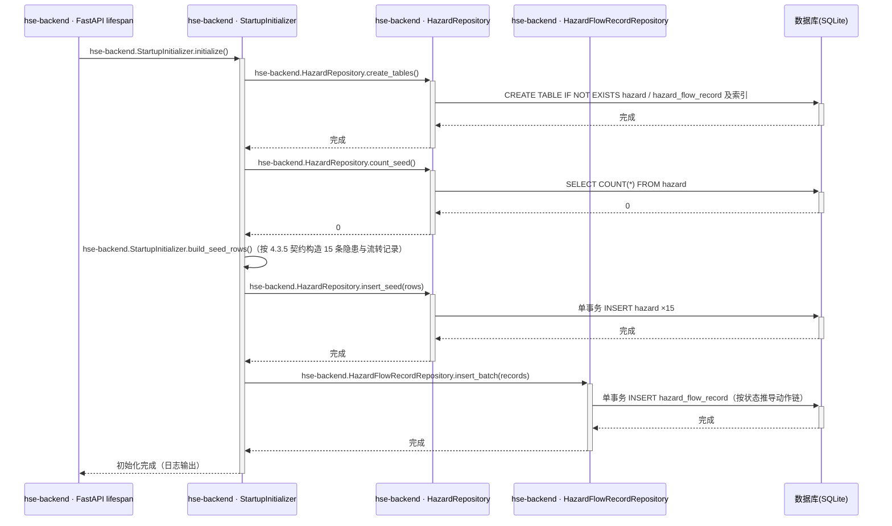

- **业务规则**：

| 规则编号 | 规则描述 | 校验时机 | 不满足时的处理 |
|---|---|---|---|
| T01-R1 | 幂等：仅当 hazard 表为空才写种子；非空直接跳过 | 启动时 | 跳过并记录日志「种子数据已存在」 |
| T01-R2 | 种子数据全部为模拟数据（虚拟姓名、模拟文案），不得含真实敏感信息 | 构造时 | 禁止写入（R8） |
| T01-R3 | 建表/种子失败则应用启动失败并输出 ERROR 日志 | 启动时 | 进程退出，提示检查 demo.db 文件权限 |

- **异常场景**：

| 异常场景 | 处理方式 |
|---|---|
| demo.db 文件被占用/无写权限 | 启动失败并输出明确错误日志，不重试 |
| 种子写入中断（事务失败） | 事务回滚，表保持空态，下次启动重新初始化 |

- **事务与并发控制**：单实例启动期执行，无并发；建表与种子各为独立事务；幂等键=「hazard 表计数=0」。

#### 4.3.5 种子数据契约（F11 详细口径）

1. 15 条隐患字段值以 PRD 4.2 种子表为唯一契约（编号/类型/等级/位置/上报人/责任人/期限/状态/创建日），禁止改动统计口径。
2. 各状态记录按下表补齐文本字段与流转记录：

| 种子状态 | 补齐字段 | 流转记录动作链（operator/时间模拟） |
|---|---|---|
| 待审核（#1） | 整改/验收字段为空 | 上报提交（operator=reporter，时间=created_at） |
| 整改中（#2/#3/#6/#7） | 整改字段为空 | 上报提交 → 审核分派（operator=安全管理人员模拟人，comment 选填） |
| 待验收（#4/#5/#8） | rectification_measure/result 填模拟文案 | 上报提交 → 审核分派 → 提交整改 |
| 已关闭（#9–#15） | rectification_measure/result 模拟文案 + acceptance_comment 模拟文案 | 上报提交 → 审核分派 → 提交整改 → 验收通过 |

3. 流转记录时间戳规则：上报提交=hazard.created_at；后续动作按小时递增模拟；**7 条已关闭记录的「验收通过」时间分布必须为 2026-11-10×2、11-11×2、11-12×3**，与 PRD 4.2 趋势契约（近 7 日 closed 0/0/0/2/2/3/0）一致。
4. 超期口径以演示日 2026-11-13 计算：#6（期限 11-08）、#7（期限 11-12）超期，对应 overdue_count=2 契约（该值为运行时派生，种子不落库）。
5. 统计契约自检基准：状态 待审核1/整改中4/待验收3/已关闭7；等级 一般8/较大5/重大2；类型 消防4/用电3/设备3/环境2/职业2/其他1；总数 15；趋势 new（11-07…11-13）=1/1/2/0/2/2/1，closed=0/0/0/2/2/3/0。

#### 4.3.6 模块自检

**功能点—接口对账表**

| F 编号 | 功能点名称 | 对应接口章节 | 时序图 | 业务规则表 | 异常场景 | 并发控制 | 状态 |
|---|---|---|---|---|---|---|---|
| F11 | 启动建库与种子初始化 | 4.3.4.1（T01） | 有 | 有 | 有 | 有（幂等键） | ✅通过 |
| F13（异常支撑） | 统一异常处理 | 4.2.1 全局约定 + 各写接口错误码 | —（全局机制，不单设时序图） | 有（各接口） | 有（各接口） | 无需 | ✅通过 |

- **表结构对账**：本模块无专属实体（4.3.1 已说明原因），种子契约落点为 4.4.1 两张表 → 通过。
- **接口对账**：T01 含触发方式/逻辑/规则/异常/时序；任务接口无 HTTP 入参出参，以规则表替代 → 通过。
- **仓储层对账**：复用 HazardRepository/HazardFlowRecordRepository 方法（来源已标注）→ 通过。
- **时序图归属对账**：4.3.4.1 时序图所有分层方法调用均带 hse-backend 前缀 → 通过。
- **状态机对账**：本模块无含状态字段的实体 → 不适用。
- **过度设计检查**：人员库不落库、不引入配置中心/缓存/MQ → 通过。

### 4.4 隐患管理模块

**模块职责**：管理隐患全生命周期数据，承载台账查询、上报、详情与状态流转动作及流转记录，是业务闭环核心。
**覆盖功能点**：F01、F02、F03、F04、F05、F06、F07、F09、F12、F13（服务端校验部分）、F10（operator 入参配合）。
**依赖模块/接口**：公共基础模块（T01 建表、IdGenerator 编号、统一异常处理、DemoPerson 常量）。

#### 4.4.1 表结构设计

##### 4.4.1.1 hazard（隐患主表）

| 字段名 | 数据类型 | 约束 | 默认值 | 说明 |
|---|---|---|---|---|
| id | INTEGER | PK，自增 | - | 系统自增主键（SQLite rowid） |
| hazard_no | TEXT | NOT NULL，UNIQUE | - | 隐患编号，YH-YYYYMMDD-NNN（R1） |
| hazard_type | TEXT | NOT NULL | - | 隐患类型枚举（见 4.4.1.3） |
| hazard_level | TEXT | NOT NULL | - | 隐患等级枚举（见 4.4.1.3） |
| location | TEXT | NOT NULL | - | 隐患位置，1–50 字符（应用层校验长度） |
| description | TEXT | NOT NULL | - | 问题描述，1–200 字符（应用层校验长度） |
| reporter | TEXT | NOT NULL | - | 上报人（演示人员常量，R8） |
| owner | TEXT | NULL | NULL | 责任人，分派（W04）后写入 |
| due_date | TEXT | NOT NULL | - | 整改期限，YYYY-MM-DD |
| status | TEXT | NOT NULL | '待审核' | 状态枚举（见 4.4.4 状态机） |
| rectification_measure | TEXT | NULL | NULL | 整改措施，≤500 字符（W05 写入） |
| rectification_result | TEXT | NULL | NULL | 整改结果，≤500 字符（W05 写入） |
| acceptance_comment | TEXT | NULL | NULL | 验收意见，≤200 字符（W06 通过时写入） |
| image_url | TEXT | NULL | NULL | 图片 URL 选填，http(s) 前缀，≤500 字符（R7/A09） |
| created_at | TEXT | NOT NULL | 应用写入当前时间 | 创建时间，ISO-8601（YYYY-MM-DD HH:mm:ss） |
| updated_at | TEXT | NOT NULL | 应用写入当前时间 | 最后更新时间，每次变更同步刷新 |

说明：SQLite TEXT 不强制长度，location/description/URL 等长度约束由 Pydantic Schema 在应用层校验（F13）；db.md「禁 timestamp/enum」以 TEXT+应用层枚举满足；字段名沿用需求 6.5（created_at/updated_at 为 PRD 指定字段名，替代 db.md 推荐的 gmt_* 命名，需求优先）。

**索引：**

- UK: `uk_hazard_no` (hazard_no) — 编号唯一，兼作编号并发兜底
- IDX: `idx_hazard_status` (status) — 状态筛选与状态计数
- IDX: `idx_hazard_due_date` (due_date) — 超期派生与超期统计
- IDX: `idx_hazard_created` (created_at) — 默认倒序分页

##### 4.4.1.2 hazard_flow_record（隐患流转记录表）

| 字段名 | 数据类型 | 约束 | 默认值 | 说明 |
|---|---|---|---|---|
| id | INTEGER | PK，自增 | - | 系统自增主键 |
| hazard_id | INTEGER | NOT NULL | - | 逻辑关联 hazard.id（规范禁外键，服务层维护） |
| action | TEXT | NOT NULL | - | 动作枚举：上报提交/审核分派/提交整改/验收通过/验收退回 |
| from_status | TEXT | NULL | NULL | 流转前状态；上报提交为 NULL |
| to_status | TEXT | NOT NULL | - | 流转后状态 |
| operator | TEXT | NOT NULL | - | 操作人（演示人员/角色模拟人，R4） |
| comment | TEXT | NULL | NULL | 操作意见（审核/退回意见等） |
| created_at | TEXT | NOT NULL | 应用写入当前时间 | 操作时间，ISO-8601 |

**索引：**

- IDX: `idx_flow_hazard` (hazard_id) — 详情页按隐患取时间轴
- IDX: `idx_flow_action_time` (action, created_at) — 「关闭」趋势按 action=验收通过 按日聚合（A4 口径）

##### 4.4.1.3 枚举与常量定义

| 枚举名称 | 取值 | 含义 | 关联字段 |
|---|---|---|---|
| HazardStatus | 待审核 / 整改中 / 待验收 / 已关闭 | 隐患状态机状态值 | hazard.status、hazard_flow_record.to_status |
| HazardLevel | 一般 / 较大 / 重大 | 隐患严重程度（A01 默认口径） | hazard.hazard_level |
| HazardType | 消防安全 / 用电安全 / 设备设施 / 环境保护 / 职业健康 / 其他 | 隐患专业分类（A02 默认口径） | hazard.hazard_type |
| FlowAction | 上报提交 / 审核分派 / 提交整改 / 验收通过 / 验收退回 | 流转动作 | hazard_flow_record.action |

说明：超期（overdue）为派生标签非状态，不落入枚举与表字段（R3）。

#### 4.4.2 仓储层设计

| 归属应用 | 仓储类 | 方法名 | 关联实体/表 | 操作类型 | 核心查询/更新条件 | 入参 | 返回值 | 说明 |
|---|---|---|---|---|---|---|---|---|
| hse-backend | HazardRepository | create_tables | hazard、hazard_flow_record | 建表 | CREATE IF NOT EXISTS + 索引 | 无 | None | T01 调用 |
| hse-backend | HazardRepository | count_seed | hazard | 查询 | COUNT(*) | 无 | int | 种子幂等判断 |
| hse-backend | HazardRepository | insert_seed | hazard | 批量新增 | 单事务批量 INSERT | list[Hazard] | None | T01 调用 |
| hse-backend | HazardRepository | find_page | hazard | 查询 | 动态 WHERE（status/hazard_level/hazard_type 精确 + keyword LIKE hazard_no/location/description）+ ORDER BY created_at DESC, id DESC + LIMIT/OFFSET | status, hazard_level, hazard_type, keyword, page, page_size | (total:int, items:list[Hazard]) | W01 |
| hse-backend | HazardRepository | find_by_id | hazard | 查询 | id = :id | id | Hazard 或 None | W03 及各写接口读回 |
| hse-backend | HazardRepository | max_seq_by_prefix | hazard | 查询 | hazard_no LIKE :prefix 取当日最大流水 | prefix | int | W02 编号生成 |
| hse-backend | HazardRepository | insert | hazard | 新增 | 单条 INSERT | Hazard | int（新 id） | W02 |
| hse-backend | HazardRepository | update_status_guarded | hazard | 更新 | UPDATE ... WHERE id=:id AND status=:expected_status（状态守卫原子更新，同时刷新 updated_at） | id, expected_status, 更新字段集 | int（影响行数） | W04/W05/W06 并发控制核心 |
| hse-backend | HazardFlowRecordRepository | insert | hazard_flow_record | 新增 | 单条 INSERT | FlowRecord | None | W02/W04/W05/W06 |
| hse-backend | HazardFlowRecordRepository | insert_batch | hazard_flow_record | 批量新增 | 单事务批量 INSERT | list[FlowRecord] | None | T01 |
| hse-backend | HazardFlowRecordRepository | list_by_hazard | hazard_flow_record | 查询 | hazard_id=:id ORDER BY created_at ASC, id ASC | hazard_id | list[FlowRecord] | W03 时间轴 |

#### 4.4.3 接口设计

| 接口编号 | 接口名称 | 类型 | 方法 | 路径 | 对应功能点 |
|---|---|---|---|---|---|
| W01 | 隐患列表查询 | oneapi | GET | /api/hazards | F01/F02/F12 |
| W02 | 隐患上报 | oneapi | POST | /api/hazards | F03/F13 |
| W03 | 隐患详情查询 | oneapi | GET | /api/hazards/{id} | F04/F09/F12 |
| W04 | 审核并分派 | oneapi | PATCH | /api/hazards/{id}/assign | F05/F10/F13 |
| W05 | 提交整改 | oneapi | PATCH | /api/hazards/{id}/rectification | F06/F10/F13 |
| W06 | 验收并关闭/退回 | oneapi | PATCH | /api/hazards/{id}/acceptance | F07/F10/F12/F13 |

##### 4.4.3.1 W01 隐患列表查询（F01/F02/F12）

- **URI**：GET /api/hazards
- **接口类型**：oneapi
- **描述**：分页查询隐患台账，支持状态/等级/类型精确筛选与关键字模糊搜索，列表项含 overdue 派生字段。
- **入参**（query）：

| 参数名称 | 类型 | 是否必填 | 描述 |
|---|---|---|---|
| page | int | 否 | 页码，默认 1，≥1 |
| page_size | int | 否 | 每页条数，默认 10，1–50 |
| status | string | 否 | 状态精确匹配（HazardStatus 枚举） |
| hazard_level | string | 否 | 等级精确匹配 |
| hazard_type | string | 否 | 类型精确匹配 |
| keyword | string | 否 | ≤50 字符，对 hazard_no/location/description 模糊匹配（LIKE，通配符转义） |

- **出参**：

| 参数名称 | 类型 | 描述 |
|---|---|---|
| total | int | 符合条件总数 |
| page | int | 当前页 |
| page_size | int | 每页条数 |
| items | array | 列表项=hazard 全部落库字段 + overdue 派生布尔（不含 flow_records） |

- **错误码**：

| 错误码 | 说明 |
|---|---|
| 422 | 参数非法（page<1、page_size>50、筛选值不在枚举白名单等） |
| 500 | 数据库访问异常 |

- **业务规则**：

| 规则编号 | 规则描述 | 校验时机 | 不满足时的处理 |
|---|---|---|---|
| W01-R1 | 多筛选条件为 AND 组合；全部可选 | 查询前 | — |
| W01-R2 | 默认排序 created_at DESC、id DESC（R6 最新在前且同秒稳定） | 固定 | — |
| W01-R3 | overdue=status≠已关闭 且 due_date<今日，服务端派生（R3/F12） | 组装出参 | — |
| W01-R4 | 空结果正常返回 items=[]（前端空态，F1-R1） | — | — |
| W01-R5 | 筛选值必须为合法枚举，防脏值静默匹配为空 | 参数校验 | 422 |

- **处理时序图**：

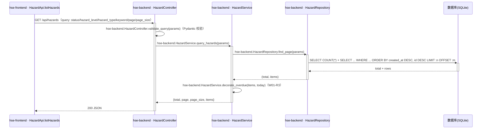

- **异常场景**：

| 异常场景 | 处理方式 |
|---|---|
| 参数非法 | 422 + detail 提示具体字段 |
| SQLite 文件异常/占用 | 500 + detail「加载失败，请稍后重试」，前端可重试（F1-R3） |
| 关键字含 % 或 _ | LIKE 通配符转义后按字面匹配，不报错 |

- **事务与并发控制**：只读接口，单条查询无事务需求；无并发风险（SQLite 读并发安全）。
- **响应示例**：

```json
{
  "total": 15,
  "page": 1,
  "page_size": 10,
  "items": [
    {
      "id": 1, "hazard_no": "YH-20261113-001", "hazard_type": "消防安全", "hazard_level": "一般",
      "location": "3号厂房东侧消防通道", "description": "消防通道堆放杂物，影响应急疏散",
      "reporter": "张伟", "owner": null, "due_date": "2026-11-18", "status": "待审核",
      "rectification_measure": null, "rectification_result": null, "acceptance_comment": null,
      "image_url": null, "overdue": false,
      "created_at": "2026-11-13 09:12:35", "updated_at": "2026-11-13 09:12:35"
    }
  ]
}
```

##### 4.4.3.2 W02 隐患上报（F03/F13）

- **URI**：POST /api/hazards
- **接口类型**：oneapi
- **描述**：提交新隐患，服务端生成编号、置状态「待审核」并写入首条流转记录，返回 201 与完整隐患对象。
- **入参**（body JSON）：

| 参数名称 | 类型 | 是否必填 | 描述 |
|---|---|---|---|
| reporter | string | 是 | 上报人，须为演示人员常量之一 |
| location | string | 是 | 隐患位置，1–50 字符 |
| hazard_type | string | 是 | 枚举白名单（6 类） |
| hazard_level | string | 是 | 枚举白名单（3 级） |
| description | string | 是 | 问题描述，1–200 字符 |
| due_date | string | 是 | YYYY-MM-DD，不早于当日 |
| image_url | string | 否 | http(s) 前缀，≤500 字符 |

- **出参**：

| 参数名称 | 类型 | 描述 |
|---|---|---|
| （完整隐患对象） | object | 201 返回：hazard 全字段 + overdue 派生（status=待审核，hazard_no 服务端生成） |

- **错误码**：

| 错误码 | 说明 |
|---|---|
| 422 | 必填缺失/长度超限/枚举非法/URL 格式错误（Pydantic 校验） |
| 400 | due_date 早于当日，detail「整改期限不能早于今天」（PRD F2 契约） |
| 500 | 服务/数据库异常 |

- **业务规则**：

| 规则编号 | 规则描述 | 校验时机 | 不满足时的处理 |
|---|---|---|---|
| W02-R1 | 前后端双重校验：前端阻断不发起请求，后端兜底（F2-R1~R3/F13） | 前端提交前 / 后端参数层 | 前端字段红字提示；后端 422/400 |
| W02-R2 | hazard_no 按 R1 生成：当日「YH-YYYYMMDD-」前缀最大流水+1，三位补零 | 写入前 | — |
| W02-R3 | 初始状态固定「待审核」；写入首条流转记录「上报提交」（operator=reporter） | 写入事务内 | — |
| W02-R4 | reporter 必须为演示人员常量（R8），防脏数据 | 参数校验 | 422 |

- **处理时序图**：

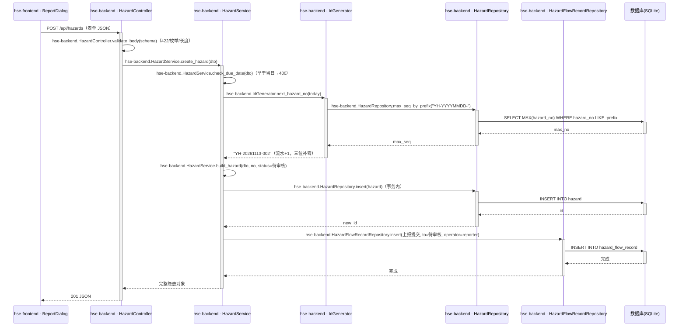

- **异常场景**：

| 异常场景 | 处理方式 |
|---|---|
| due_date 早于当日 | 400「整改期限不能早于今天」（前端同时拦截，F2-R3） |
| 编号唯一冲突（极端并发同流水） | 捕获 IntegrityError，重取流水重试（最多 3 次），仍失败返回 500 |
| 服务异常/DB 不可用 | 500「上报失败：原因」，前端保留表单内容（F2-R5） |

- **事务与并发控制**：单事务（INSERT hazard + INSERT flow record），任一失败整体回滚；编号并发依赖 uk_hazard_no 唯一索引 + 重试兜底（单机演示并发极低，不引入分布式锁）。
- **请求示例**：

```json
{
  "reporter": "张伟",
  "location": "3号厂房东侧消防通道",
  "hazard_type": "消防安全",
  "hazard_level": "一般",
  "description": "消防通道堆放杂物，影响应急疏散",
  "due_date": "2026-11-18",
  "image_url": null
}
```

- **响应示例**：201 + 完整隐患对象（结构同 W01 列表项，status=待审核，hazard_no=YH-20261113-002）。

##### 4.4.3.3 W03 隐患详情查询（F04/F09/F12）

- **URI**：GET /api/hazards/{id}
- **接口类型**：oneapi
- **描述**：返回隐患完整信息 + overdue 派生 + flow_records 时间轴（流转记录仅详情接口返回，PRD F1 说明）。
- **入参**：

| 参数名称 | 类型 | 是否必填 | 描述 |
|---|---|---|---|
| id | int（path） | 是 | 隐患主键 |

- **出参**：

| 参数名称 | 类型 | 描述 |
|---|---|---|
| （隐患字段） | object | 同 W01 列表项字段 + overdue |
| flow_records | array | 每条：id/action/from_status/to_status/operator/comment/created_at，按时间正序（最早→最近） |

- **错误码**：

| 错误码 | 说明 |
|---|---|
| 404 | 隐患不存在，detail「隐患不存在」 |
| 500 | 数据库访问异常 |

- **业务规则**：

| 规则编号 | 规则描述 | 校验时机 | 不满足时的处理 |
|---|---|---|---|
| W03-R1 | id 必须存在 | 查询后 | 404 |
| W03-R2 | flow_records 按 created_at、id 正序输出，支撑时间轴 | 组装出参 | — |
| W03-R3 | overdue 派生口径同 W01-R3 | 组装出参 | — |

- **处理时序图**：

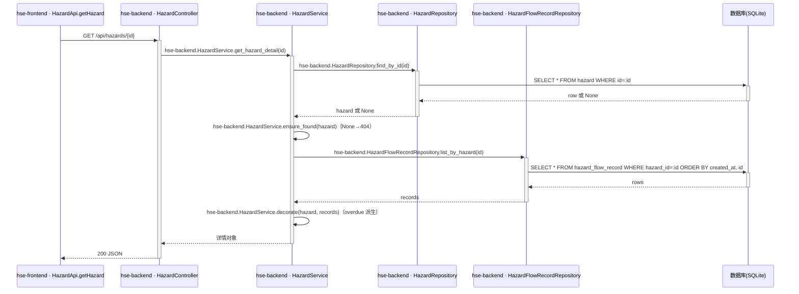

- **异常场景**：

| 异常场景 | 处理方式 |
|---|---|
| 隐患不存在 | 404「隐患不存在」 |
| DB 异常 | 500「加载失败，请稍后重试」 |

- **事务与并发控制**：只读，无事务；无并发风险。
- **响应示例**：200 + 隐患对象，其中 `"flow_records": [{"id": 1, "action": "上报提交", "from_status": null, "to_status": "待审核", "operator": "张伟", "comment": null, "created_at": "2026-11-13 09:12:35"}]`。

##### 4.4.3.4 W04 审核并分派（F05/F10/F13）

- **URI**：PATCH /api/hazards/{id}/assign
- **接口类型**：oneapi
- **描述**：安全管理人员对待审核隐患分派责任人并设定整改期限，状态待审核→整改中，追加「审核分派」流转记录；返回更新后完整对象（含 flow_records）。
- **入参**（body）：

| 参数名称 | 类型 | 是否必填 | 描述 |
|---|---|---|---|
| owner | string | 是 | 责任人，演示人员常量之一；为空 400 |
| due_date | string | 否 | 整改期限 YYYY-MM-DD；缺省沿用上报值（A6）；显式传入时不早于当日 |
| comment | string | 否 | 审核意见，≤200 字符 |
| operator | string | 是 | 操作人（当前角色对应演示人，R4/F10） |

- **出参**：

| 参数名称 | 类型 | 描述 |
|---|---|---|
| （完整隐患对象） | object | 200：更新后 hazard 全字段 + overdue + flow_records（新增「审核分派」） |

- **错误码**：

| 错误码 | 说明 |
|---|---|
| 400 | owner/operator 为空；显式传入的 due_date 早于当日 |
| 404 | 隐患不存在 |
| 409 | 状态非「待审核」，detail「当前状态已变化，请刷新后重试」（R2） |
| 422 | 字段长度/格式非法 |

- **业务规则**：

| 规则编号 | 规则描述 | 校验时机 | 不满足时的处理 |
|---|---|---|---|
| W04-R1 | 仅「待审核」可执行；由 UPDATE ... WHERE id=:id AND status='待审核' 原子保证 | 写入时 | rowcount=0 → 409（R2/F3-R6） |
| W04-R2 | owner 必填且为演示人员常量 | 参数校验 | 400/422 |
| W04-R3 | due_date 缺省沿用上报值；显式传入时校验不早于当日（A6） | 参数校验 | 400 |
| W04-R4 | 成功后落库 owner/due_date/status=整改中/updated_at，并追加流转记录（from=待审核，to=整改中，operator，comment） | 写入事务内 | — |

- **处理时序图**：

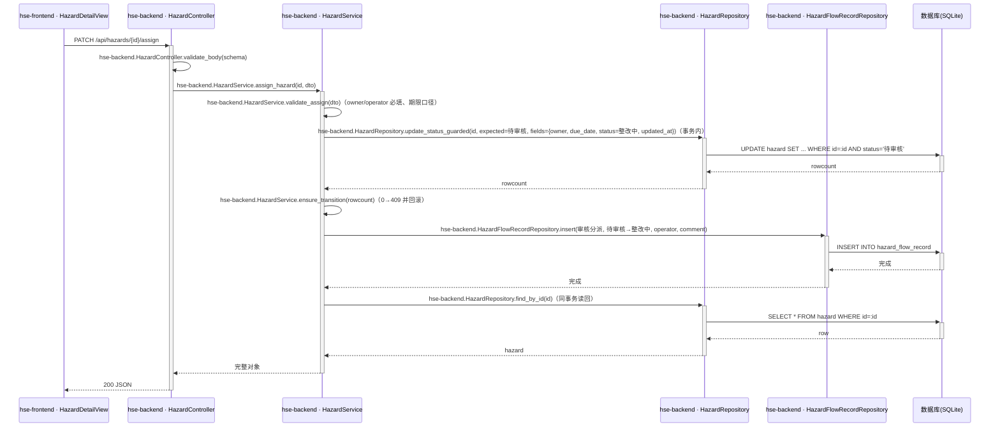

- **异常场景**：

| 异常场景 | 处理方式 |
|---|---|
| 并发重复分派（两人同时提交） | 仅一个事务的守卫 UPDATE 命中，另一事务 rowcount=0 → 409 并整体回滚 |
| 隐患不存在 | 404 |
| 参数缺失/非法 | 400/422 |

- **事务与并发控制**：单事务（守卫 UPDATE + 流转 INSERT，任一失败回滚）；并发控制=状态守卫更新（乐观语义，见决策 Step 5），无需版本号/分布式锁；重复提交第二次必 409（状态已变），天然幂等防护。
- **请求示例**：

```json
{"owner": "李强", "due_date": "2026-11-18", "comment": "请于期限内清理", "operator": "陈静"}
```

- **响应示例**：200 + 完整对象（status=整改中，flow_records 新增「审核分派」）。

##### 4.4.3.5 W05 提交整改（F06/F10/F13）

- **URI**：PATCH /api/hazards/{id}/rectification
- **接口类型**：oneapi
- **描述**：责任人对整改中隐患提交整改措施与结果，状态整改中→待验收，追加「提交整改」流转记录。
- **入参**（body）：

| 参数名称 | 类型 | 是否必填 | 描述 |
|---|---|---|---|
| measure | string | 是 | 整改措施，1–500 字符 |
| result | string | 是 | 整改结果，1–500 字符（演示口径如「已清理并设置禁放标识」） |
| operator | string | 是 | 操作人（责任人，R4/F10） |

- **出参**：

| 参数名称 | 类型 | 描述 |
|---|---|---|
| （完整隐患对象） | object | 200：更新后 hazard 全字段 + overdue + flow_records（新增「提交整改」） |

- **错误码**：

| 错误码 | 说明 |
|---|---|
| 400 | measure/result/operator 为空 |
| 404 | 隐患不存在 |
| 409 | 状态非「整改中」（R2） |
| 422 | 长度超限 |

- **业务规则**：

| 规则编号 | 规则描述 | 校验时机 | 不满足时的处理 |
|---|---|---|---|
| W05-R1 | 仅「整改中」可执行（守卫 UPDATE ... WHERE status='整改中'） | 写入时 | 409 |
| W05-R2 | measure/result 落库至 rectification_measure/rectification_result，status→待验收，updated_at 刷新 | 写入事务内 | — |
| W05-R3 | 追加流转记录（from=整改中，to=待验收，operator） | 写入事务内 | — |
| W05-R4 | 验收退回后再次提交时覆盖原整改字段（A5：退回保留旧值供展示，重新提交即更新） | 写入事务内 | — |

- **处理时序图**：

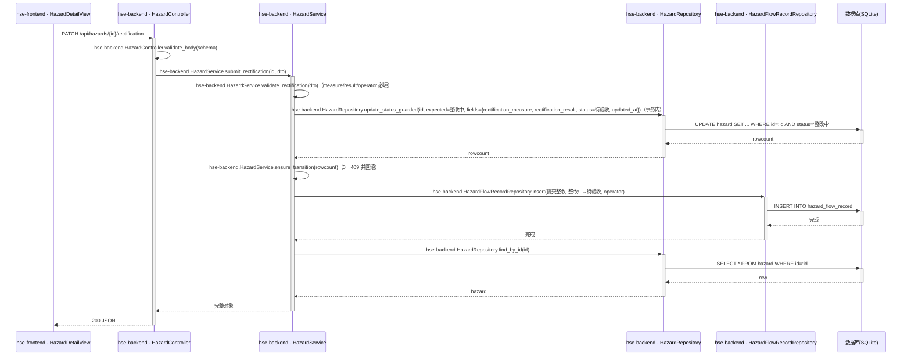

- **异常场景**：

| 异常场景 | 处理方式 |
|---|---|
| 并发重复提交整改 | 守卫 UPDATE 未命中 → 409 并回滚 |
| 隐患不存在 / 参数缺失 | 404 / 400 |

- **事务与并发控制**：同 W04（单事务+状态守卫）。
- **请求示例**：

```json
{"measure": "清理通道并复位消防设施", "result": "已清理并设置禁放标识", "operator": "李强"}
```

- **响应示例**：200 + 完整对象（status=待验收，flow_records 新增「提交整改」）。

##### 4.4.3.6 W06 验收并关闭/退回（F07/F10/F12/F13）

- **URI**：PATCH /api/hazards/{id}/acceptance
- **接口类型**：oneapi
- **描述**：安全管理人员对待验收隐患验收：通过（accepted=true）→已关闭并落验收意见；退回（accepted=false）→回整改中，保留原整改信息并追加「验收退回」记录。
- **入参**（body）：

| 参数名称 | 类型 | 是否必填 | 描述 |
|---|---|---|---|
| accepted | bool | 是 | true=验收通过关闭；false=退回整改 |
| comment | string | 否 | 验收意见，≤200 字符；通过时写入 acceptance_comment；退回时仅记入流转记录（W06-R4） |
| operator | string | 是 | 操作人（R4/F10） |

- **出参**：

| 参数名称 | 类型 | 描述 |
|---|---|---|
| （完整隐患对象） | object | 200：更新后 hazard 全字段 + overdue + flow_records（新增「验收通过」或「验收退回」） |

- **错误码**：

| 错误码 | 说明 |
|---|---|
| 400 | accepted/operator 缺失或类型非法 |
| 404 | 隐患不存在 |
| 409 | 状态非「待验收」（R2；对已关闭隐患重复验收亦 409） |
| 422 | 长度超限 |

- **业务规则**：

| 规则编号 | 规则描述 | 校验时机 | 不满足时的处理 |
|---|---|---|---|
| W06-R1 | 仅「待验收」可执行（守卫 UPDATE ... WHERE status='待验收'） | 写入时 | 409 |
| W06-R2 | accepted=true：status→已关闭，acceptance_comment=comment（可空），追加「验收通过」记录——该记录时间即统计「关闭」口径（A4） | 写入事务内 | — |
| W06-R3 | accepted=false：status→整改中，保留 rectification_measure/result（A5），追加「验收退回」记录（comment 为退回意见） | 写入事务内 | — |
| W06-R4 | 退回时验收意见不写 acceptance_comment 字段，待最终通过时写入，避免退回历史污染最终验收字段（与 PRD F3-R4/R5 一致的落地口径） | 写入事务内 | — |
| W06-R5 | 退回后责任人可再次 W05 提交整改（覆盖整改字段），闭环可循环 | — | — |

- **处理时序图**：

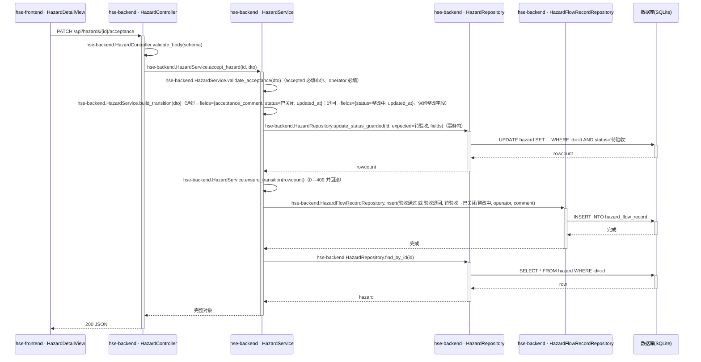

- **异常场景**：

| 异常场景 | 处理方式 |
|---|---|
| 并发验收冲突 | 守卫 UPDATE 未命中 → 409 并回滚 |
| 对已关闭隐患重复验收 | 409（F3 验收标准 5） |
| 隐患不存在 / accepted 缺失 | 404 / 400 |

- **事务与并发控制**：同 W04（单事务+状态守卫）；重复操作返回 409，天然幂等防护。
- **请求示例**：

```json
{"accepted": true, "comment": "整改到位，验收通过", "operator": "陈静"}
```

```json
{"accepted": false, "comment": "清理不彻底，请补设标识", "operator": "陈静"}
```

- **响应示例**：200 + 完整对象（status=已关闭 或 整改中，flow_records 新增对应动作）。

#### 4.4.4 状态机设计

hazard.status 状态机（唯一合法迁移，需求 6.6/R2）：

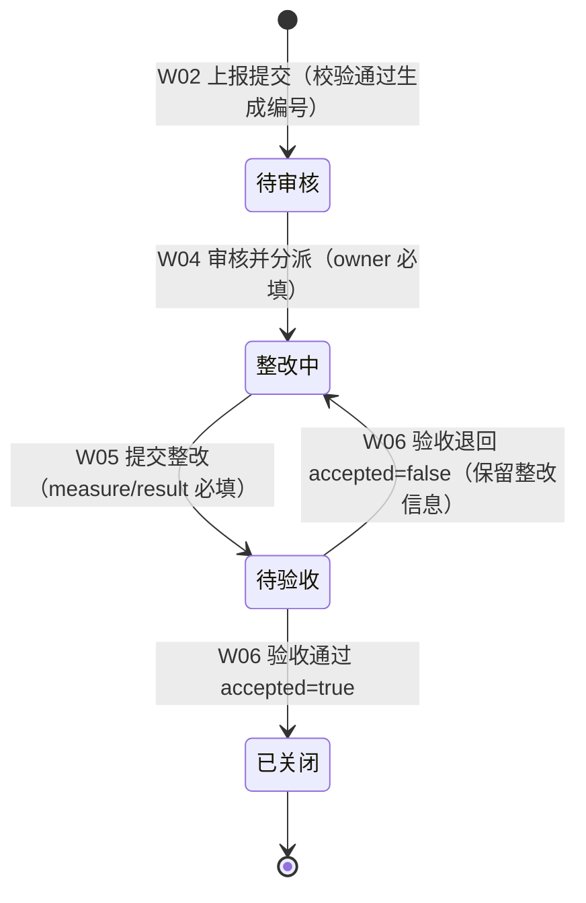

**状态流转规则：**

| 当前状态 | 目标状态 | 流转条件 | 前置校验 | 触发动作（事务内） | 对应接口 |
|---|---|---|---|---|---|
| 待审核 | 整改中 | 安全管理人员提交分派 | owner/operator 必填；期限口径（W04-R2/R3）；守卫 status=待审核 | 更新 owner/due_date/status/updated_at + 追加「审核分派」记录 | W04 |
| 整改中 | 待验收 | 责任人提交整改 | measure/result/operator 必填；守卫 status=整改中 | 更新整改字段/status/updated_at + 追加「提交整改」记录 | W05 |
| 待验收 | 已关闭 | accepted=true | operator 必填；守卫 status=待验收 | 更新 acceptance_comment/status/updated_at + 追加「验收通过」记录 | W06 |
| 待验收 | 整改中 | accepted=false | operator 必填；守卫 status=待验收 | 更新 status/updated_at（保留整改字段）+ 追加「验收退回」记录 | W06 |

补充规则：任何不匹配当前状态的操作返回 409（R2）；「超期」为 overdue 派生标签，不改变状态机（R3）；无孤岛状态（待审核由 W02 唯一进入，已关闭为终态）。

#### 4.4.5 模块自检

**功能点—接口对账表**

| F 编号 | 功能点名称 | 对应接口章节 | 时序图 | 业务规则表 | 异常场景 | 并发控制 | 状态 |
|---|---|---|---|---|---|---|---|
| F01 | 台账分页列表 | 4.4.3.1（W01） | 有 | 有 | 有 | 无需（只读） | ✅通过 |
| F02 | 多条件筛选 | 4.4.3.1（W01） | 有 | 有 | 有 | 无需（只读） | ✅通过 |
| F03 | 隐患上报 | 4.4.3.2（W02） | 有 | 有 | 有 | 有（编号唯一+重试） | ✅通过 |
| F04 | 详情查询 | 4.4.3.3（W03） | 有 | 有 | 有 | 无需（只读） | ✅通过 |
| F05 | 审核并分派 | 4.4.3.4（W04） | 有 | 有 | 有 | 有（状态守卫） | ✅通过 |
| F06 | 提交整改 | 4.4.3.5（W05） | 有 | 有 | 有 | 有（状态守卫） | ✅通过 |
| F07 | 验收通过/退回 | 4.4.3.6（W06） | 有 | 有 | 有 | 有（状态守卫） | ✅通过 |
| F09 | 流转记录时间轴 | 4.4.3.3（W03 flow_records） | 有 | 有 | 有 | 无需（只读） | ✅通过 |
| F10 | 角色显隐（后端配合） | W04/W05/W06 的 operator 必填入参 + 4.2.3 前端要点 | 引用 W04/W05/W06 | 有（operator 必填） | 有 | 引用状态守卫 | ✅通过 |
| F12 | 超期派生 | W01-R3/W03-R3（服务端派生）+ W07 统计 | 引用 W01 | 有 | 引用 | 无需 | ✅通过 |
| F13 | 服务端校验部分 | W02–W06 校验规则与错误码 | 引用各接口 | 有 | 有 | — | ✅通过 |

- **表结构对账**：hazard（16 字段+4 索引）、hazard_flow_record（8 字段+2 索引）均已完整定义 → 通过。
- **接口对账**：W01–W06 均含 URI/入参表/出参/错误码/业务规则/时序图/异常/并发/示例 → 通过。
- **仓储层对账**：时序图中全部持久化操作（find_page/find_by_id/max_seq_by_prefix/insert/insert_seed/count_seed/update_status_guarded/insert/insert_batch/list_by_hazard）均可在 4.4.2 找到定义 → 通过。
- **时序图归属对账**：W01–W06 时序图所有 Controller/Service/Repository 方法调用均为「hse-backend.类名.方法名」格式，前端调用方标注 hse-frontend，数据库节点为泛化 SQL → 通过。
- **状态机对账**：含状态字段的实体=hazard（status），已产出状态机图与流转规则表；hazard_flow_record.action 为动作枚举、非实体状态字段，不适用状态机 → 通过。
- **过度设计检查**：未引入缓存/MQ/分布式锁/version 字段（状态守卫已满足演示级并发）；无当前阶段不需要的预留设计 → 通过。

### 4.5 统计模块

**模块职责**：对隐患数据进行只读聚合统计，输出看板所需的计数、分布与趋势。
**覆盖功能点**：F08、F12。
**依赖模块/接口**：公共基础模块（统一异常）；只读访问 4.4.1 定义的 hazard / hazard_flow_record 表。

#### 4.5.1 表结构设计

本模块无专属表结构，原因：统计为只读聚合，复用隐患管理模块两张表（4.4.1），不落任何统计结果表（F4-R1 要求实时计算不缓存）。

#### 4.5.2 枚举与常量定义

本模块无新增枚举；统计维度取值复用 4.4.1.3 的 HazardStatus/HazardLevel/HazardType；趋势窗口常量=近 7 个自然日（含当日）。

#### 4.5.3 仓储层设计

| 归属应用 | 仓储类 | 方法名 | 关联实体/表 | 操作类型 | 核心查询/更新条件 | 入参 | 返回值 | 说明 |
|---|---|---|---|---|---|---|---|---|
| hse-backend | StatisticsRepository | count_total | hazard | 查询 | COUNT(*) | 无 | int | total |
| hse-backend | StatisticsRepository | group_count | hazard | 查询 | GROUP BY :field（status/hazard_level/hazard_type 白名单字段） | field | dict[str, int] | by_status/by_level/by_type |
| hse-backend | StatisticsRepository | count_overdue | hazard | 查询 | status≠'已关闭' AND due_date<:today | today | int | overdue_count（F4-R2） |
| hse-backend | StatisticsRepository | trend_new | hazard | 查询 | date(created_at) 在窗口内 GROUP BY date(created_at) | start_date, end_date | dict[date, int] | 趋势·新增 |
| hse-backend | StatisticsRepository | trend_closed | hazard_flow_record | 查询 | action='验收通过' AND date(created_at) 在窗口内 GROUP BY date(created_at) | start_date, end_date | dict[date, int] | 趋势·关闭（A4 口径） |

#### 4.5.4 接口设计

| 接口编号 | 接口名称 | 类型 | 方法 | 路径 | 对应功能点 |
|---|---|---|---|---|---|
| W07 | 隐患统计查询 | oneapi | GET | /api/hazards/statistics | F08/F12 |

##### 4.5.4.1 W07 隐患统计查询（F08/F12）

- **URI**：GET /api/hazards/statistics
- **接口类型**：oneapi
- **描述**：一次返回看板全部统计：总数、超期数、状态/等级/类型分布、近 7 日新增/关闭趋势。
- **入参**：无（无查询参数；趋势窗口固定为含当日的近 7 个自然日）。
- **出参**：

| 参数名称 | 类型 | 描述 |
|---|---|---|
| total | int | 隐患总数 |
| overdue_count | int | 超期未关闭数（status≠已关闭 且 due_date<今日，F4-R2） |
| by_status | object | 待审核/整改中/待验收/已关闭 计数（缺失维度补 0） |
| by_level | object | 一般/较大/重大 计数（补 0） |
| by_type | object | 6 类计数（补 0） |
| trend | array | 7 个元素：{date, new, closed}，按日期升序，无数据补 0 |

- **错误码**：

| 错误码 | 说明 |
|---|---|
| 500 | 数据库访问异常，前端卡片置「—」并图表空态（F4-R3） |

- **业务规则**：

| 规则编号 | 规则描述 | 校验时机 | 不满足时的处理 |
|---|---|---|---|
| W07-R1 | 实时聚合计算，不缓存（F4-R1） | — | — |
| W07-R2 | 超期口径 status≠已关闭 且 due_date<今日（F4-R2） | 查询 | — |
| W07-R3 | 「关闭」按 hazard_flow_record.action=验收通过 的 created_at 日期聚合（A4） | 查询 | — |
| W07-R4 | 分布字典按枚举全量输出（计数为 0 的维度也返回），保证前端渲染稳定 | 组装 | — |
| W07-R5 | 趋势窗口=含当日的近 7 个自然日，日期升序补 0 | 组装 | — |

- **处理时序图**：

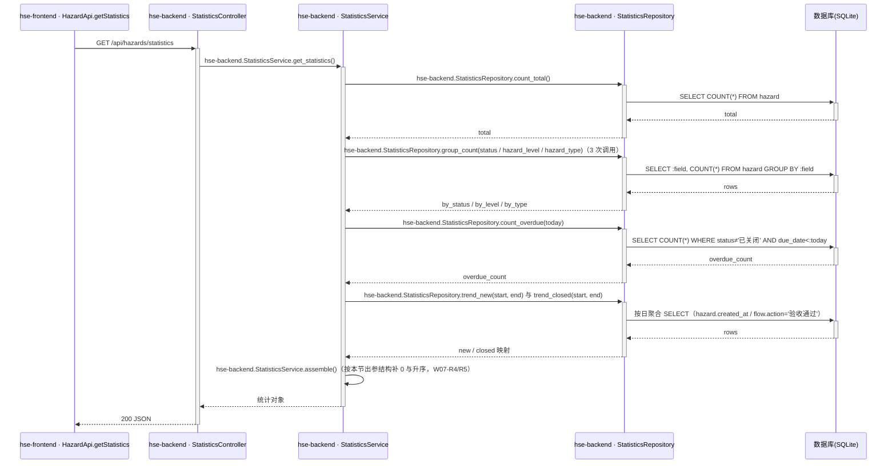

- **异常场景**：

| 异常场景 | 处理方式 |
|---|---|
| DB 异常/文件占用 | 500「加载失败，请稍后重试」；前端卡片「—」+ 图表空态 + 重试（F4-R3） |
| 枚举出现脏值（绕过接口写入） | group_count 仅按白名单字段聚合，输出按枚举全量补 0（W07-R4） |

- **事务与并发控制**：只读接口、多条独立 SELECT（演示并发极低且各计数间无强一致要求）；无并发风险。
- **响应示例**：与 PRD 3.4 统计接口示例一致（total=15、overdue_count=2、by_status 待审核1/整改中4/待验收3/已关闭7、by_level 8/5/2、by_type 4/3/3/2/2/1、trend 7 项）；种子契约基准见 4.3.5。

#### 4.5.5 模块自检

**功能点—接口对账表**

| F 编号 | 功能点名称 | 对应接口章节 | 时序图 | 业务规则表 | 异常场景 | 并发控制 | 状态 |
|---|---|---|---|---|---|---|---|
| F08 | 统计看板数据 | 4.5.4.1（W07） | 有 | 有 | 有 | 无需（只读） | ✅通过 |
| F12 | 超期统计 | 4.5.4.1（W07 overdue_count，W07-R2） | 有 | 有 | 引用 | 无需（只读） | ✅通过 |

- **表结构对账**：无专属实体（4.5.1 已说明），复用表已定义 → 通过。
- **接口对账**：W07 完整（入参无/出参表/错误码/规则/时序/异常/并发/示例引用种子契约）→ 通过。
- **仓储层对账**：时序图中 count_total/group_count/count_overdue/trend_new/trend_closed 均已定义 → 通过。
- **时序图归属对账**：全部分层调用带 hse-backend 前缀 → 通过。
- **状态机对账**：本模块无含状态字段的实体 → 不适用。
- **过度设计检查**：不落统计结果表、不引入缓存（F4-R1 明确不缓存）→ 通过。

## 5. 非功能性需求设计

### 5.1 非功能验收表

| 验收编号 | 维度 | 目标/阈值 | 测量口径与周期 | 监控或告警 | 验证方法 | 责任方 | 验收状态 | 依据/假设 |
|---|---|---|---|---|---|---|---|---|
| NFR-01 | 性能 | 列表 W01 与统计 W07 本机响应 <1s；详情/流转操作 <1s | uvicorn 访问日志耗时字段，每次请求 | 无独立告警（单机演示），日志人工抽查 | 演示全链路实测 + 日志抽查 | 开发 | 待验证 | PRD F1/F4 专项要求（演示口径，非生产 SLA） |
| NFR-02 | 容量 | 支撑演示规模（种子 15 条 + 演示期新增数百条内）；SQLite 单文件 | 演示期间人工观察 | 无 | 现场演示核验 | 开发 | 待验证 | 需求 3.1.5；超规模需迁移集中式库（见 NFR-04） |
| NFR-03 | 可用性 | 本项不适用，原因：单机演示，需求 3.3 明确排除服务器部署与高可用目标 | — | — | — | — | 不适用 | 需求 3.3 |
| NFR-04 | 扩展性 | 数据访问经 ORM 与仓储层隔离；表/字段命名与类型遵循 db.md 规范，SQLite→MySQL 平移无结构阻碍；分页/筛选服务端实现 | 代码评审 | 无 | 设计评审 + 代码走查 | 开发 | 待验证 | 决策 Step 5（SQLAlchemy 选型） |
| NFR-05 | 可观测性 | 每次请求输出访问日志（方法/路径/状态码/耗时）；流转操作输出业务 INFO 日志（隐患号/动作/操作人） | 每次请求/操作 | 日志文件人工核查（演示无告警系统） | 抽查日志记录完整性 | 开发 | 待验证 | 第 6 章可监控设计 |
| NFR-06 | 可靠性/灾备 | 本项不适用，原因：本机演示无 RTO/RPO 要求；数据可通过删除 demo.db 重启恢复种子态（见 6.3 应急） | — | — | — | — | 不适用 | 需求 3.3 |

### 5.2 安全验收表

| 验收编号 | 资产/接口 | 风险或控制目标 | 设计措施 | 验证证据 | 责任方 | 验收状态 | 例外及审批 |
|---|---|---|---|---|---|---|---|
| SEC-01 | 全部数据 | 数据分级：全部为模拟数据，禁止真实敏感信息（人员/生产数据/未脱敏文档） | 种子与演示数据仅虚拟姓名（R8）；无手机号/证件/邮箱/密码字段 | 种子数据评审（4.3.5 契约） | 开发 | 待验证 | 需求 3.3 强制约束 |
| SEC-02 | 全部接口 | 认证 | 本项不适用：演示无登录（顶栏角色模拟 R4/A07） | 演示核验 | 开发 | 不适用 | 例外：需求 3.3 明确豁免生产级认证；仅本机运行无公网暴露 |
| SEC-03 | W04/W05/W06 | 水平权限（操作资格） | 后端不校验操作人身份（演示口径），但 operator 必填并落流转记录留痕；前端按角色×状态显隐入口 | 操作留痕抽查（flow_records） | 开发 | 待验证 | 例外：需求 3.3 豁免复杂权限；转生产必须接入认证与权限校验 |
| SEC-04 | W01–W07 | 注入与非法输入 | Pydantic 全量入参校验 + SQLAlchemy 参数化 SQL + LIKE 通配符转义 + 枚举白名单 | 恶意输入用例（SQL 片段、% 通配、超长串）实测 | 开发 | 待验证 | — |
| SEC-05 | 传输链路 | 传输保护 | 本机 HTTP（localhost:5173/8000） | 演示环境核验 | 开发 | 不适用 | 例外：本机演示无公网暴露（需求 3.3）；公网部署需 HTTPS |
| SEC-06 | 展示与日志 | 展示与日志脱敏 | 本项不适用，原因：无敏感字段（SEC-01） | — | — | 不适用 | — |
| SEC-07 | 流转操作 | 审计 | hazard_flow_record 记录每次状态变化（动作/操作人/意见/时间），构成业务审计流水 | 详情页时间轴与表数据核对 | 开发 | 待验证 | — |

### 5.3 数据迁移验收表

| 迁移编号 | 变更对象 | 前向方案 | 兼容性策略 | 回填/初始化 | 校验标准 | 回滚方案 | 执行窗口 | 责任方 | 验收状态 |
|---|---|---|---|---|---|---|---|---|---|
| MIG-01 | 新增表 hazard、hazard_flow_record 及索引 | T01 启动钩子自动建表（CREATE TABLE IF NOT EXISTS） | 首次交付无存量数据，无新旧版本并存 | hazard 表为空时写入 15 条种子 + 按状态推导的流转记录（4.3.5 契约，含验收通过时间分布） | 统计契约核对：状态 1/4/3/7、等级 8/5/2、类型 4/3/3/2/2/1、超期 2、趋势 new=1/1/2/0/2/2/1、closed=0/0/0/2/2/3/0 | 停服务 → 删除 demo.db → 重启自动重建 | 首次启动 | 开发 | 待验证 |

说明：本项目为绿地演示系统，无存量数据迁移；后续版本若变更表结构，须遵循「新增列带默认值或可空、不删除字段、不收紧类型」的兼容规则（db.md），并按需补充迁移条目。

## 6. 变更三板斧

### 6.1 可监控

- 接口层：uvicorn 访问日志记录每次请求的方法/路径/状态码/耗时（NFR-05），覆盖 W01–W07 全部「调用的服务、处理结果、处理耗时」。
- 业务层：上报（W02）与三个流转接口（W04/W05/W06）成功后输出 INFO 日志：隐患编号、动作、操作人、耗时；失败输出 WARN（409 状态冲突）/ERROR（异常），便于演示现场快速定位。
- 数据层：hazard_flow_record 即业务审计流水（谁、何时、做了什么、状态从哪到哪）；SQLite 文件体积演示期人工观察（无独立 DB 监控组件，演示规模不需要）。
- 说明：单机演示不接入 APM/告警平台；以上日志埋点为本地文件日志，满足「变更可观察」的演示需求。

### 6.2 可灰度

- 不适用原因：单机单实例演示系统，无多实例部署与多租户流量，不存在灰度引流对象（需求 3.3 排除服务器部署）。
- 等效能力：T01 种子初始化为幂等设计，删除 demo.db 重启即可将系统重置回初始演示态；前端为静态资源，刷新即取最新版本。演示环境的「重置」即等价的发布隔离手段。

### 6.3 可应急

- 数据应急：演示数据被误改/污染时，停服务 → 删除 backend/demo.db → 重启，T01 自动重建种子（幂等，见 MIG-01 回滚方案），恢复时间 <1 分钟。
- 代码应急：前后端同仓同版本交付，无下游服务依赖；git 回退至上一版本并重启两端进程即可，不存在「回滚后下游不兼容」问题（无外部系统、无消息契约、无对外 API）。
- 兼容性约束：后续迭代中 W01–W07 新增字段必须可选/带默认值，状态机合法迁移不得删除（R2 为前后端共同契约），避免前后端版本不一致导致 4xx。
- 开关说明：不设置功能开关，原因：功能面小且无生产流量，「重建数据 + 版本回退」即最快应急手段（满足应急方案越简单越好的原则）。
