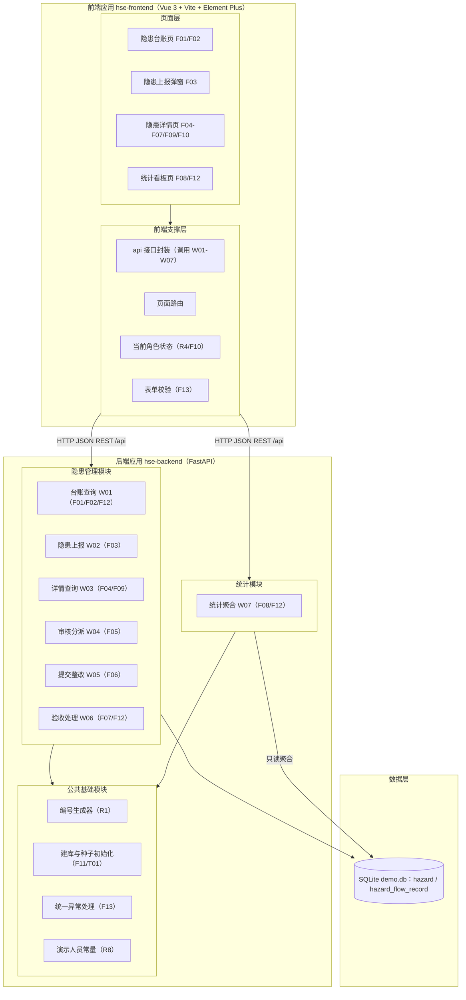
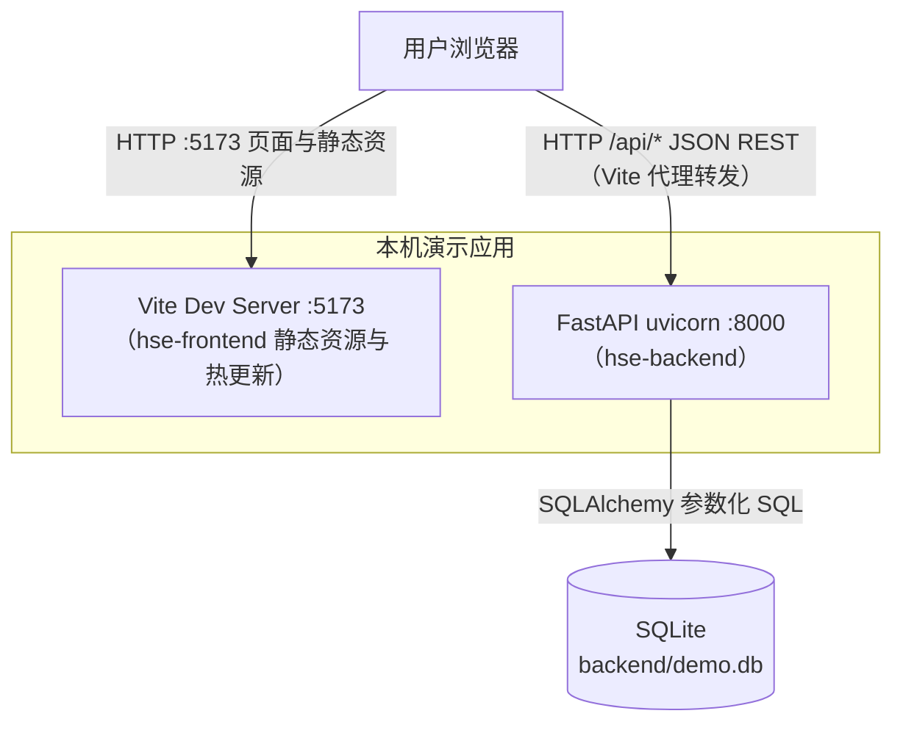
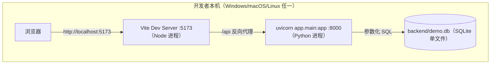

## Step 2: 架构与模块

## 2. 架构与模块

### 2.1 功能架构

层级说明：

- **前端页面层**：台账/详情/看板 3 个页面视图 + 上报弹窗组件，承担 F10 角色显隐与 F13 交互体验；图表采用 ECharts（Element Plus 无图表组件，需求 6.3.4 要求柱状/饼/折线图）。
- **前端支撑层**：api 封装（唯一后端调用出口）、路由（`/` 台账默认首页、`/hazards/:id` 详情、`/dashboard` 看板）、当前角色状态、表单校验。
- **公共基础模块**：编号生成（R1）、启动建库与种子（F11/T01）、统一异常处理（F13 错误响应支撑）、演示人员常量（R8）。
- **隐患管理模块**：隐患查询/上报/详情与三个流转操作及流转记录，业务闭环核心。
- **统计模块**：只读聚合（状态/等级/类型计数、超期数、近 7 日趋势），无写操作。

**模块清单**

| 模块 | 职责说明 | 包含的功能点 | 依赖的模块 |
|---|---|---|---|
| 前端·页面层（hse-frontend views） | 台账/详情/看板页面渲染与交互，上报弹窗 | F01、F02、F03、F04、F05、F06、F07、F08、F09、F10、F12、F13 | 前端·支撑层 |
| 前端·支撑层（hse-frontend api/router/store） | 接口封装、路由、当前角色状态、表单校验 | F10、F13（支撑） | 无 |
| 后端·公共基础模块 | 编号生成、启动建库与种子初始化、统一异常处理、演示人员常量 | F11、F03（编号支撑）、F13（异常响应支撑） | 无 |
| 后端·隐患管理模块 | 隐患全生命周期数据管理与状态流转控制 | F01–F07、F09、F12、F13（入参校验） | 公共基础模块 |
| 后端·统计模块 | 隐患统计聚合查询（只读） | F08、F12 | 公共基础模块（读 hazard 表仓储） |

依赖关系为单向无环：页面层→支撑层→后端业务模块→公共基础；隐患管理与统计互不依赖（统计仅只读 hazard 表），无循环依赖。

### 2.2 应用集成架构

**集成关系说明**

| 调用方 | 被调用方 | 协议 | 接口类型 | 说明 |
|---|---|---|---|---|
| 用户浏览器 | hse-frontend（Vite :5173） | HTTP | 页面/静态资源 | 开发服务器托管页面（需求 2.3） |
| 用户浏览器 | hse-backend（:8000） | HTTP | oneapi REST（W01–W07） | 经 Vite 代理 /api → 8000 规避跨域；后端另启用 CORS 中间件兜底 |
| hse-backend | SQLite demo.db | 文件级 SQL | 仓储层 | SQLAlchemy 参数化访问，单文件随项目目录 |

外部系统集成：**本项不适用，原因：演示系统不接入任何外部系统（需求 3.3），无 OpenAPI/集成接口。**

### 2.3 部署架构

**部署说明**

- 单机单实例双进程：Node（前端）+ Python（后端）；启动命令按需求 2.3（`npm run dev` / `uvicorn app.main:app --reload --port 8000`），端口可调并以 README 记录的最终地址为准。
- 数据层为 SQLite 单文件 demo.db，随项目目录存放；删除文件重启即可恢复种子初始态。
- 单点说明：本机演示形态允许单点（需求 3.3 明确排除服务器部署与高可用要求），不构成设计缺陷；未来转生产需替换集中式数据库并增加实例冗余（见第 5 章 NFR-04）。
