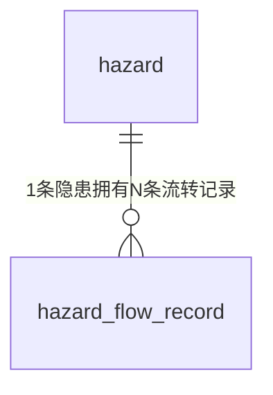

## Step 3: 数据模型与存储

## 3. 数据模型与存储

### 3.1 实体清单

| 实体名称 | 实体说明 | 所属模块 | 与其他实体的关系 |
|---|---|---|---|
| hazard（隐患） | 闭环核心业务对象：编号、类型、等级、位置、描述、上报/责任人、期限、状态及整改/验收信息 | 后端·隐患管理模块 | 一对多关联 hazard_flow_record |
| hazard_flow_record（隐患流转记录） | 每次状态动作（上报提交/审核分派/提交整改/验收通过/验收退回）的操作人、前后状态与意见，支撑详情时间轴与「关闭」趋势统计 | 后端·隐患管理模块 | 多对一关联 hazard |

说明：

- 统计模块不新增实体，仅对 hazard / hazard_flow_record 做只读聚合。
- 公共基础模块无落库实体：演示人员库（张伟/陈静/王芳/李强/刘洋/赵敏，R8）为前后端代码常量，不建表（避免过度设计，见决策文件 Step 3）。

### 3.2 实体关系图

### 3.3 模型说明

1. 关联完整性由服务层维护：references/db.md 禁止使用外键约束，hazard_flow_record.hazard_id 为逻辑关联，应用层保证写入前 hazard 存在；hazard_id 建普通索引保障按隐患查询流转记录。
2. 租户隔离：**本项不适用，原因：单机演示、无多租户诉求（需求 3.3），不设计 tenant 字段。**
3. 缓存/MQ：不引入。数据量小（种子 15 条 + 演示增量），且 F4-R1 要求统计实时计算不缓存，SQLite 直查即可满足 <1s 目标。
4. 命名与类型遵循 references/db.md 并做 SQLite 适配：表名小写单数且 ≤26 字符（hazard_flow_record 共 18 字符）；整形单列自增主键；不使用外键/触发器/视图；不使用 enum 列类型（状态/类型/等级以 TEXT + 应用层枚举常量约束）；时间字段以 TEXT 存 ISO-8601（SQLite 无 datetime 类型，db.md「禁 timestamp」的意图由应用层统一格式满足）；布尔语义派生字段（overdue）不落库。
5. 字段级表结构定义在第 4 章 4.4 隐患管理模块给出。
