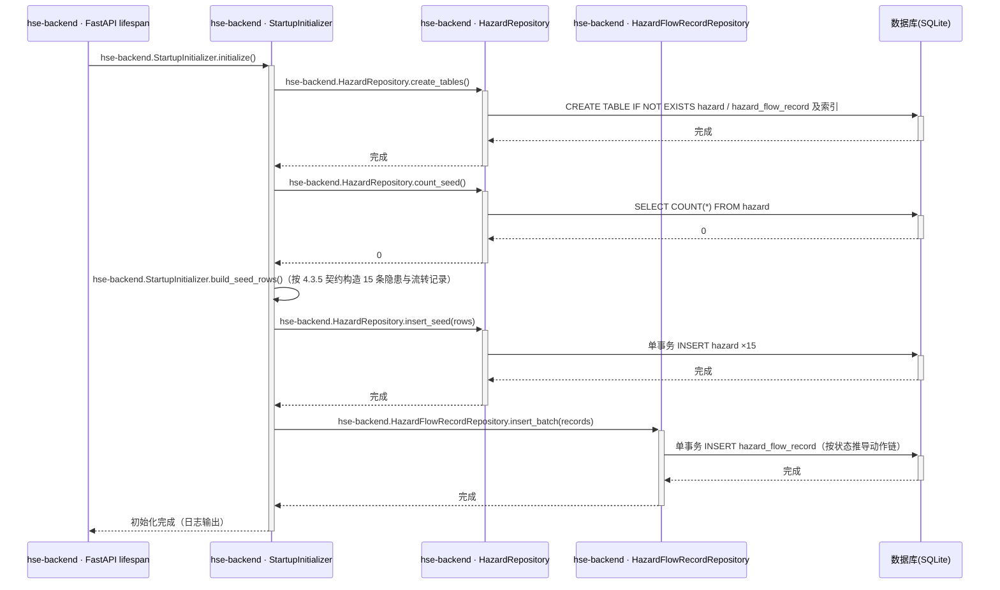

## Step 5: 功能模块与接口详细设计 - 公共基础模块

### 4.3 公共基础模块

**模块职责**：为业务模块提供编号生成、启动建库与演示种子数据初始化、统一异常处理与演示人员常量。
**覆盖功能点**：F11（主）、F03（编号生成支撑）、F13（异常响应支撑）。
**依赖模块/接口**：无（最底层模块）。

#### 4.3.1 表结构设计

本模块无专属表结构，原因：种子数据写入隐患管理模块的 hazard / hazard_flow_record 表（见 4.4.1）；演示人员库为 6 个固定虚拟姓名的代码常量（R8），无管理界面与变更需求，落库无收益。

#### 4.3.2 枚举与常量定义

| 名称 | 取值 | 含义 | 关联字段/用途 |
|---|---|---|---|
| DemoPerson | 张伟/陈静/王芳/李强/刘洋/赵敏 | 模拟人员库（上报人下拉、责任人下拉、角色演示人） | hazard.reporter / hazard.owner / 流转 operator（R8） |
| 编号规则 | YH-YYYYMMDD-NNN（NNN=001 起当日递增，三位补零） | 隐患编号生成规则（R1/A03） | hazard.hazard_no |

#### 4.3.3 仓储层设计

本模块不独立定义仓储类，原因：无专属持久化实体；建表与种子写入复用 4.4.2 定义的 HazardRepository.create_tables() / count_seed() / insert_seed()（来源：隐患管理模块仓储），编号流水查询复用 HazardRepository.max_seq_by_prefix()。

#### 4.3.4 接口设计

| 接口编号 | 接口名称 | 类型 | 方法/触发方式 | 路径/方法签名 | 对应功能点 |
|---|---|---|---|---|---|
| T01 | 启动建库与种子初始化 | 任务 | FastAPI lifespan 启动钩子 | hse-backend.StartupInitializer.initialize() | F11 |

##### 4.3.4.1 T01 启动建库与种子初始化（F11）

- **类型**：任务（内部启动钩子，无 HTTP 入口）
- **描述**：应用启动时自动建表；hazard 表为空时写入 15 条演示种子及其流转记录（幂等，非空则跳过），满足需求 3.1.5。
- **入参**：无。
- **出参**：无返回值；初始化结果写入启动日志（建表数/种子条数）。
- **错误码**：本项不适用，原因：任务接口无 HTTP 契约，失败以启动失败与 ERROR 日志承载（见异常场景）。
- **处理时序图**：

- **业务规则**：

| 规则编号 | 规则描述 | 校验时机 | 不满足时的处理 |
|---|---|---|---|
| T01-R1 | 幂等：仅当 hazard 表为空才写种子；非空直接跳过 | 启动时 | 跳过并记录日志「种子数据已存在」 |
| T01-R2 | 种子数据全部为模拟数据（虚拟姓名、模拟文案），不得含真实敏感信息 | 构造时 | 禁止写入（R8） |
| T01-R3 | 建表/种子失败则应用启动失败并输出 ERROR 日志 | 启动时 | 进程退出，提示检查 demo.db 文件权限 |

- **异常场景**：

| 异常场景 | 处理方式 |
|---|---|
| demo.db 文件被占用/无写权限 | 启动失败并输出明确错误日志，不重试 |
| 种子写入中断（事务失败） | 事务回滚，表保持空态，下次启动重新初始化 |

- **事务与并发控制**：单实例启动期执行，无并发；建表与种子各为独立事务；幂等键=「hazard 表计数=0」。

#### 4.3.5 种子数据契约（F11 详细口径）

1. 15 条隐患字段值以 PRD 4.2 种子表为唯一契约（编号/类型/等级/位置/上报人/责任人/期限/状态/创建日），禁止改动统计口径。
2. 各状态记录按下表补齐文本字段与流转记录：

| 种子状态 | 补齐字段 | 流转记录动作链（operator/时间模拟） |
|---|---|---|
| 待审核（#1） | 整改/验收字段为空 | 上报提交（operator=reporter，时间=created_at） |
| 整改中（#2/#3/#6/#7） | 整改字段为空 | 上报提交 → 审核分派（operator=安全管理人员模拟人，comment 选填） |
| 待验收（#4/#5/#8） | rectification_measure/result 填模拟文案 | 上报提交 → 审核分派 → 提交整改 |
| 已关闭（#9–#15） | rectification_measure/result 模拟文案 + acceptance_comment 模拟文案 | 上报提交 → 审核分派 → 提交整改 → 验收通过 |

3. 流转记录时间戳规则：上报提交=hazard.created_at；后续动作按小时递增模拟；**7 条已关闭记录的「验收通过」时间分布必须为 2026-11-10×2、11-11×2、11-12×3**，与 PRD 4.2 趋势契约（近 7 日 closed 0/0/0/2/2/3/0）一致。
4. 超期口径以演示日 2026-11-13 计算：#6（期限 11-08）、#7（期限 11-12）超期，对应 overdue_count=2 契约（该值为运行时派生，种子不落库）。
5. 统计契约自检基准：状态 待审核1/整改中4/待验收3/已关闭7；等级 一般8/较大5/重大2；类型 消防4/用电3/设备3/环境2/职业2/其他1；总数 15；趋势 new（11-07…11-13）=1/1/2/0/2/2/1，closed=0/0/0/2/2/3/0。

#### 4.3.6 模块自检

**功能点—接口对账表**

| F 编号 | 功能点名称 | 对应接口章节 | 时序图 | 业务规则表 | 异常场景 | 并发控制 | 状态 |
|---|---|---|---|---|---|---|---|
| F11 | 启动建库与种子初始化 | 4.3.4.1（T01） | 有 | 有 | 有 | 有（幂等键） | ✅通过 |
| F13（异常支撑） | 统一异常处理 | 4.2.1 全局约定 + 各写接口错误码 | —（全局机制，不单设时序图） | 有（各接口） | 有（各接口） | 无需 | ✅通过 |

- **表结构对账**：本模块无专属实体（4.3.1 已说明原因），种子契约落点为 4.4.1 两张表 → 通过。
- **接口对账**：T01 含触发方式/逻辑/规则/异常/时序；任务接口无 HTTP 入参出参，以规则表替代 → 通过。
- **仓储层对账**：复用 HazardRepository/HazardFlowRecordRepository 方法（来源已标注）→ 通过。
- **时序图归属对账**：4.3.4.1 时序图所有分层方法调用均带 hse-backend 前缀 → 通过。
- **状态机对账**：本模块无含状态字段的实体 → 不适用。
- **过度设计检查**：人员库不落库、不引入配置中心/缓存/MQ → 通过。
