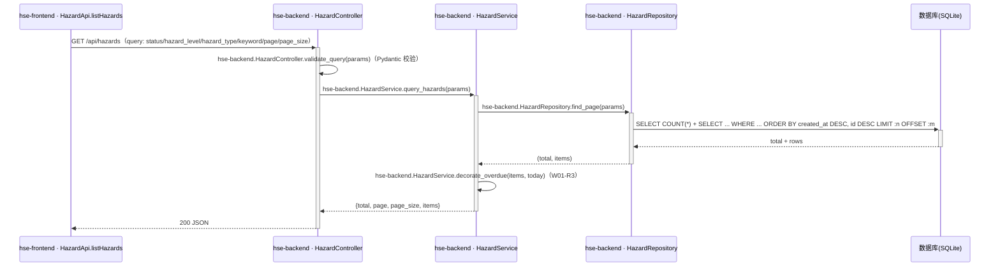
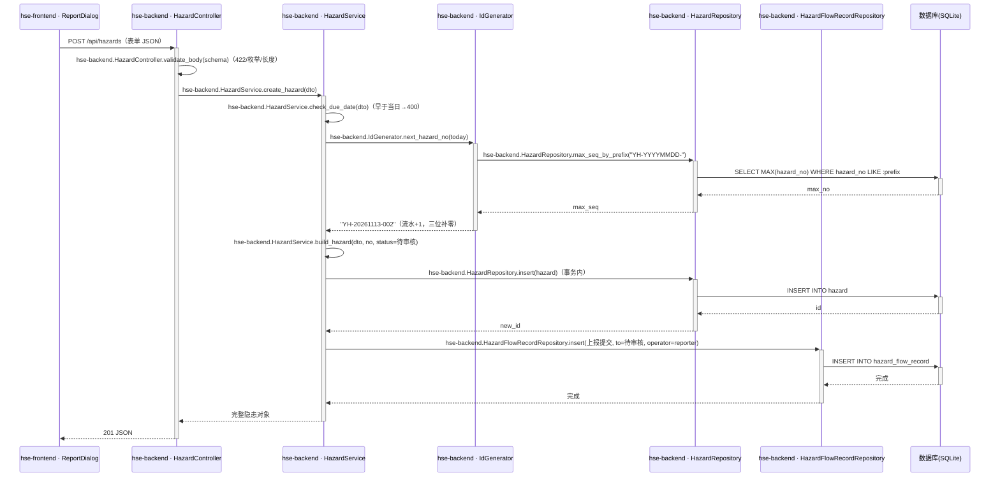
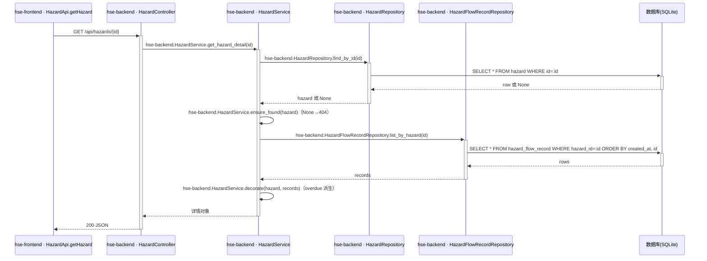
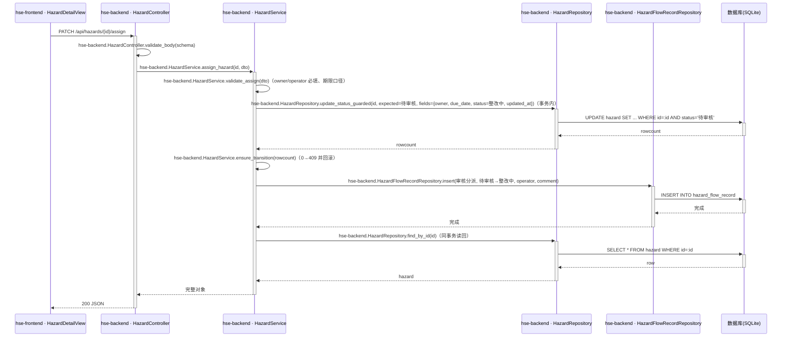
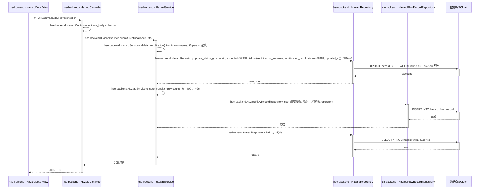
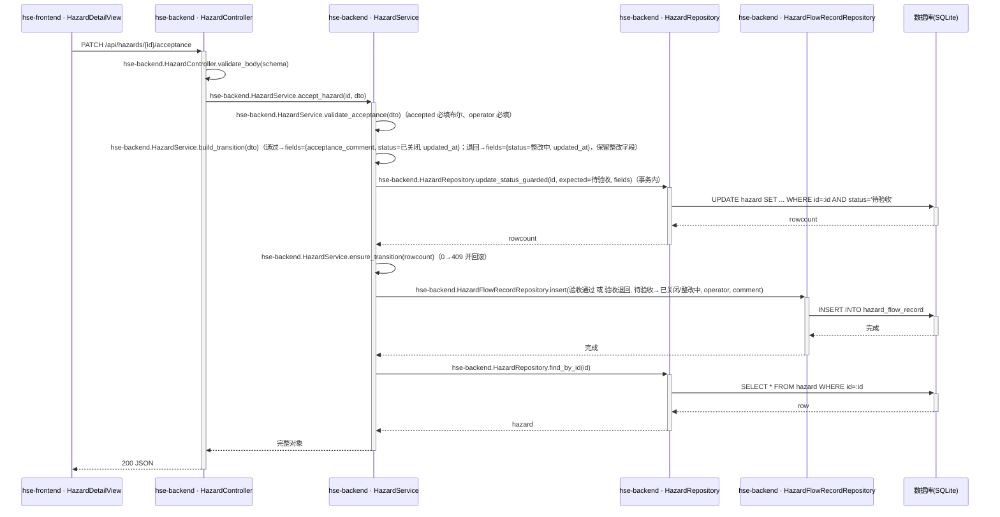
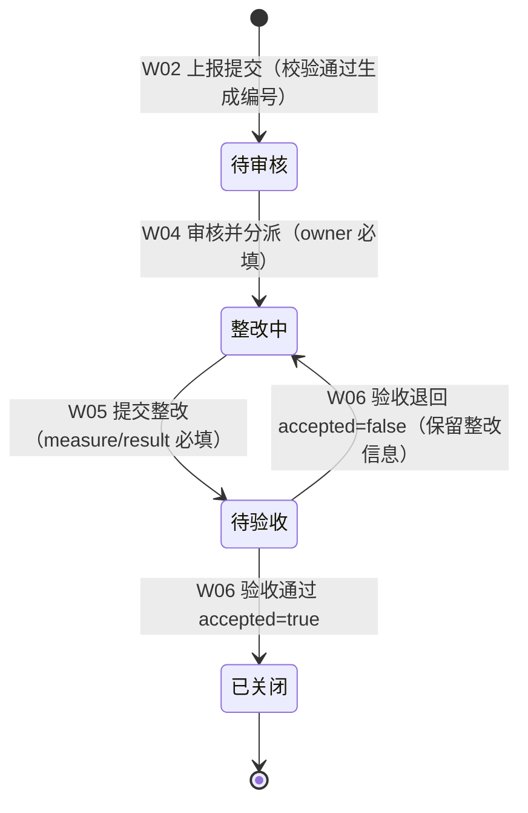

## Step 5: 功能模块与接口详细设计 - 隐患管理模块

### 4.4 隐患管理模块

**模块职责**：管理隐患全生命周期数据，承载台账查询、上报、详情与状态流转动作及流转记录，是业务闭环核心。
**覆盖功能点**：F01、F02、F03、F04、F05、F06、F07、F09、F12、F13（服务端校验部分）、F10（operator 入参配合）。
**依赖模块/接口**：公共基础模块（T01 建表、IdGenerator 编号、统一异常处理、DemoPerson 常量）。

#### 4.4.1 表结构设计

##### 4.4.1.1 hazard（隐患主表）

| 字段名 | 数据类型 | 约束 | 默认值 | 说明 |
|---|---|---|---|---|
| id | INTEGER | PK，自增 | - | 系统自增主键（SQLite rowid） |
| hazard_no | TEXT | NOT NULL，UNIQUE | - | 隐患编号，YH-YYYYMMDD-NNN（R1） |
| hazard_type | TEXT | NOT NULL | - | 隐患类型枚举（见 4.4.1.3） |
| hazard_level | TEXT | NOT NULL | - | 隐患等级枚举（见 4.4.1.3） |
| location | TEXT | NOT NULL | - | 隐患位置，1–50 字符（应用层校验长度） |
| description | TEXT | NOT NULL | - | 问题描述，1–200 字符（应用层校验长度） |
| reporter | TEXT | NOT NULL | - | 上报人（演示人员常量，R8） |
| owner | TEXT | NULL | NULL | 责任人，分派（W04）后写入 |
| due_date | TEXT | NOT NULL | - | 整改期限，YYYY-MM-DD |
| status | TEXT | NOT NULL | '待审核' | 状态枚举（见 4.4.4 状态机） |
| rectification_measure | TEXT | NULL | NULL | 整改措施，≤500 字符（W05 写入） |
| rectification_result | TEXT | NULL | NULL | 整改结果，≤500 字符（W05 写入） |
| acceptance_comment | TEXT | NULL | NULL | 验收意见，≤200 字符（W06 通过时写入） |
| image_url | TEXT | NULL | NULL | 图片 URL 选填，http(s) 前缀，≤500 字符（R7/A09） |
| created_at | TEXT | NOT NULL | 应用写入当前时间 | 创建时间，ISO-8601（YYYY-MM-DD HH:mm:ss） |
| updated_at | TEXT | NOT NULL | 应用写入当前时间 | 最后更新时间，每次变更同步刷新 |

说明：SQLite TEXT 不强制长度，location/description/URL 等长度约束由 Pydantic Schema 在应用层校验（F13）；db.md「禁 timestamp/enum」以 TEXT+应用层枚举满足；字段名沿用需求 6.5（created_at/updated_at 为 PRD 指定字段名，替代 db.md 推荐的 gmt_* 命名，需求优先）。

**索引：**

- UK: `uk_hazard_no` (hazard_no) — 编号唯一，兼作编号并发兜底
- IDX: `idx_hazard_status` (status) — 状态筛选与状态计数
- IDX: `idx_hazard_due_date` (due_date) — 超期派生与超期统计
- IDX: `idx_hazard_created` (created_at) — 默认倒序分页

##### 4.4.1.2 hazard_flow_record（隐患流转记录表）

| 字段名 | 数据类型 | 约束 | 默认值 | 说明 |
|---|---|---|---|---|
| id | INTEGER | PK，自增 | - | 系统自增主键 |
| hazard_id | INTEGER | NOT NULL | - | 逻辑关联 hazard.id（规范禁外键，服务层维护） |
| action | TEXT | NOT NULL | - | 动作枚举：上报提交/审核分派/提交整改/验收通过/验收退回 |
| from_status | TEXT | NULL | NULL | 流转前状态；上报提交为 NULL |
| to_status | TEXT | NOT NULL | - | 流转后状态 |
| operator | TEXT | NOT NULL | - | 操作人（演示人员/角色模拟人，R4） |
| comment | TEXT | NULL | NULL | 操作意见（审核/退回意见等） |
| created_at | TEXT | NOT NULL | 应用写入当前时间 | 操作时间，ISO-8601 |

**索引：**

- IDX: `idx_flow_hazard` (hazard_id) — 详情页按隐患取时间轴
- IDX: `idx_flow_action_time` (action, created_at) — 「关闭」趋势按 action=验收通过 按日聚合（A4 口径）

##### 4.4.1.3 枚举与常量定义

| 枚举名称 | 取值 | 含义 | 关联字段 |
|---|---|---|---|
| HazardStatus | 待审核 / 整改中 / 待验收 / 已关闭 | 隐患状态机状态值 | hazard.status、hazard_flow_record.to_status |
| HazardLevel | 一般 / 较大 / 重大 | 隐患严重程度（A01 默认口径） | hazard.hazard_level |
| HazardType | 消防安全 / 用电安全 / 设备设施 / 环境保护 / 职业健康 / 其他 | 隐患专业分类（A02 默认口径） | hazard.hazard_type |
| FlowAction | 上报提交 / 审核分派 / 提交整改 / 验收通过 / 验收退回 | 流转动作 | hazard_flow_record.action |

说明：超期（overdue）为派生标签非状态，不落入枚举与表字段（R3）。

#### 4.4.2 仓储层设计

| 归属应用 | 仓储类 | 方法名 | 关联实体/表 | 操作类型 | 核心查询/更新条件 | 入参 | 返回值 | 说明 |
|---|---|---|---|---|---|---|---|---|
| hse-backend | HazardRepository | create_tables | hazard、hazard_flow_record | 建表 | CREATE IF NOT EXISTS + 索引 | 无 | None | T01 调用 |
| hse-backend | HazardRepository | count_seed | hazard | 查询 | COUNT(*) | 无 | int | 种子幂等判断 |
| hse-backend | HazardRepository | insert_seed | hazard | 批量新增 | 单事务批量 INSERT | list[Hazard] | None | T01 调用 |
| hse-backend | HazardRepository | find_page | hazard | 查询 | 动态 WHERE（status/hazard_level/hazard_type 精确 + keyword LIKE hazard_no/location/description）+ ORDER BY created_at DESC, id DESC + LIMIT/OFFSET | status, hazard_level, hazard_type, keyword, page, page_size | (total:int, items:list[Hazard]) | W01 |
| hse-backend | HazardRepository | find_by_id | hazard | 查询 | id = :id | id | Hazard 或 None | W03 及各写接口读回 |
| hse-backend | HazardRepository | max_seq_by_prefix | hazard | 查询 | hazard_no LIKE :prefix 取当日最大流水 | prefix | int | W02 编号生成 |
| hse-backend | HazardRepository | insert | hazard | 新增 | 单条 INSERT | Hazard | int（新 id） | W02 |
| hse-backend | HazardRepository | update_status_guarded | hazard | 更新 | UPDATE ... WHERE id=:id AND status=:expected_status（状态守卫原子更新，同时刷新 updated_at） | id, expected_status, 更新字段集 | int（影响行数） | W04/W05/W06 并发控制核心 |
| hse-backend | HazardFlowRecordRepository | insert | hazard_flow_record | 新增 | 单条 INSERT | FlowRecord | None | W02/W04/W05/W06 |
| hse-backend | HazardFlowRecordRepository | insert_batch | hazard_flow_record | 批量新增 | 单事务批量 INSERT | list[FlowRecord] | None | T01 |
| hse-backend | HazardFlowRecordRepository | list_by_hazard | hazard_flow_record | 查询 | hazard_id=:id ORDER BY created_at ASC, id ASC | hazard_id | list[FlowRecord] | W03 时间轴 |

#### 4.4.3 接口设计

| 接口编号 | 接口名称 | 类型 | 方法 | 路径 | 对应功能点 |
|---|---|---|---|---|---|
| W01 | 隐患列表查询 | oneapi | GET | /api/hazards | F01/F02/F12 |
| W02 | 隐患上报 | oneapi | POST | /api/hazards | F03/F13 |
| W03 | 隐患详情查询 | oneapi | GET | /api/hazards/{id} | F04/F09/F12 |
| W04 | 审核并分派 | oneapi | PATCH | /api/hazards/{id}/assign | F05/F10/F13 |
| W05 | 提交整改 | oneapi | PATCH | /api/hazards/{id}/rectification | F06/F10/F13 |
| W06 | 验收并关闭/退回 | oneapi | PATCH | /api/hazards/{id}/acceptance | F07/F10/F12/F13 |

##### 4.4.3.1 W01 隐患列表查询（F01/F02/F12）

- **URI**：GET /api/hazards
- **接口类型**：oneapi
- **描述**：分页查询隐患台账，支持状态/等级/类型精确筛选与关键字模糊搜索，列表项含 overdue 派生字段。
- **入参**（query）：

| 参数名称 | 类型 | 是否必填 | 描述 |
|---|---|---|---|
| page | int | 否 | 页码，默认 1，≥1 |
| page_size | int | 否 | 每页条数，默认 10，1–50 |
| status | string | 否 | 状态精确匹配（HazardStatus 枚举） |
| hazard_level | string | 否 | 等级精确匹配 |
| hazard_type | string | 否 | 类型精确匹配 |
| keyword | string | 否 | ≤50 字符，对 hazard_no/location/description 模糊匹配（LIKE，通配符转义） |

- **出参**：

| 参数名称 | 类型 | 描述 |
|---|---|---|
| total | int | 符合条件总数 |
| page | int | 当前页 |
| page_size | int | 每页条数 |
| items | array | 列表项=hazard 全部落库字段 + overdue 派生布尔（不含 flow_records） |

- **错误码**：

| 错误码 | 说明 |
|---|---|
| 422 | 参数非法（page<1、page_size>50、筛选值不在枚举白名单等） |
| 500 | 数据库访问异常 |

- **业务规则**：

| 规则编号 | 规则描述 | 校验时机 | 不满足时的处理 |
|---|---|---|---|
| W01-R1 | 多筛选条件为 AND 组合；全部可选 | 查询前 | — |
| W01-R2 | 默认排序 created_at DESC、id DESC（R6 最新在前且同秒稳定） | 固定 | — |
| W01-R3 | overdue=status≠已关闭 且 due_date<今日，服务端派生（R3/F12） | 组装出参 | — |
| W01-R4 | 空结果正常返回 items=[]（前端空态，F1-R1） | — | — |
| W01-R5 | 筛选值必须为合法枚举，防脏值静默匹配为空 | 参数校验 | 422 |

- **处理时序图**：



- **异常场景**：

| 异常场景 | 处理方式 |
|---|---|
| 参数非法 | 422 + detail 提示具体字段 |
| SQLite 文件异常/占用 | 500 + detail「加载失败，请稍后重试」，前端可重试（F1-R3） |
| 关键字含 % 或 _ | LIKE 通配符转义后按字面匹配，不报错 |

- **事务与并发控制**：只读接口，单条查询无事务需求；无并发风险（SQLite 读并发安全）。
- **响应示例**：

```json
{
  "total": 15,
  "page": 1,
  "page_size": 10,
  "items": [
    {
      "id": 1, "hazard_no": "YH-20261113-001", "hazard_type": "消防安全", "hazard_level": "一般",
      "location": "3号厂房东侧消防通道", "description": "消防通道堆放杂物，影响应急疏散",
      "reporter": "张伟", "owner": null, "due_date": "2026-11-18", "status": "待审核",
      "rectification_measure": null, "rectification_result": null, "acceptance_comment": null,
      "image_url": null, "overdue": false,
      "created_at": "2026-11-13 09:12:35", "updated_at": "2026-11-13 09:12:35"
    }
  ]
}
```

##### 4.4.3.2 W02 隐患上报（F03/F13）

- **URI**：POST /api/hazards
- **接口类型**：oneapi
- **描述**：提交新隐患，服务端生成编号、置状态「待审核」并写入首条流转记录，返回 201 与完整隐患对象。
- **入参**（body JSON）：

| 参数名称 | 类型 | 是否必填 | 描述 |
|---|---|---|---|
| reporter | string | 是 | 上报人，须为演示人员常量之一 |
| location | string | 是 | 隐患位置，1–50 字符 |
| hazard_type | string | 是 | 枚举白名单（6 类） |
| hazard_level | string | 是 | 枚举白名单（3 级） |
| description | string | 是 | 问题描述，1–200 字符 |
| due_date | string | 是 | YYYY-MM-DD，不早于当日 |
| image_url | string | 否 | http(s) 前缀，≤500 字符 |

- **出参**：

| 参数名称 | 类型 | 描述 |
|---|---|---|
| （完整隐患对象） | object | 201 返回：hazard 全字段 + overdue 派生（status=待审核，hazard_no 服务端生成） |

- **错误码**：

| 错误码 | 说明 |
|---|---|
| 422 | 必填缺失/长度超限/枚举非法/URL 格式错误（Pydantic 校验） |
| 400 | due_date 早于当日，detail「整改期限不能早于今天」（PRD F2 契约） |
| 500 | 服务/数据库异常 |

- **业务规则**：

| 规则编号 | 规则描述 | 校验时机 | 不满足时的处理 |
|---|---|---|---|
| W02-R1 | 前后端双重校验：前端阻断不发起请求，后端兜底（F2-R1~R3/F13） | 前端提交前 / 后端参数层 | 前端字段红字提示；后端 422/400 |
| W02-R2 | hazard_no 按 R1 生成：当日「YH-YYYYMMDD-」前缀最大流水+1，三位补零 | 写入前 | — |
| W02-R3 | 初始状态固定「待审核」；写入首条流转记录「上报提交」（operator=reporter） | 写入事务内 | — |
| W02-R4 | reporter 必须为演示人员常量（R8），防脏数据 | 参数校验 | 422 |

- **处理时序图**：



- **异常场景**：

| 异常场景 | 处理方式 |
|---|---|
| due_date 早于当日 | 400「整改期限不能早于今天」（前端同时拦截，F2-R3） |
| 编号唯一冲突（极端并发同流水） | 捕获 IntegrityError，重取流水重试（最多 3 次），仍失败返回 500 |
| 服务异常/DB 不可用 | 500「上报失败：原因」，前端保留表单内容（F2-R5） |

- **事务与并发控制**：单事务（INSERT hazard + INSERT flow record），任一失败整体回滚；编号并发依赖 uk_hazard_no 唯一索引 + 重试兜底（单机演示并发极低，不引入分布式锁）。
- **请求示例**：

```json
{
  "reporter": "张伟",
  "location": "3号厂房东侧消防通道",
  "hazard_type": "消防安全",
  "hazard_level": "一般",
  "description": "消防通道堆放杂物，影响应急疏散",
  "due_date": "2026-11-18",
  "image_url": null
}
```

- **响应示例**：201 + 完整隐患对象（结构同 W01 列表项，status=待审核，hazard_no=YH-20261113-002）。

##### 4.4.3.3 W03 隐患详情查询（F04/F09/F12）

- **URI**：GET /api/hazards/{id}
- **接口类型**：oneapi
- **描述**：返回隐患完整信息 + overdue 派生 + flow_records 时间轴（流转记录仅详情接口返回，PRD F1 说明）。
- **入参**：

| 参数名称 | 类型 | 是否必填 | 描述 |
|---|---|---|---|
| id | int（path） | 是 | 隐患主键 |

- **出参**：

| 参数名称 | 类型 | 描述 |
|---|---|---|
| （隐患字段） | object | 同 W01 列表项字段 + overdue |
| flow_records | array | 每条：id/action/from_status/to_status/operator/comment/created_at，按时间正序（最早→最近） |

- **错误码**：

| 错误码 | 说明 |
|---|---|
| 404 | 隐患不存在，detail「隐患不存在」 |
| 500 | 数据库访问异常 |

- **业务规则**：

| 规则编号 | 规则描述 | 校验时机 | 不满足时的处理 |
|---|---|---|---|
| W03-R1 | id 必须存在 | 查询后 | 404 |
| W03-R2 | flow_records 按 created_at、id 正序输出，支撑时间轴 | 组装出参 | — |
| W03-R3 | overdue 派生口径同 W01-R3 | 组装出参 | — |

- **处理时序图**：



- **异常场景**：

| 异常场景 | 处理方式 |
|---|---|
| 隐患不存在 | 404「隐患不存在」 |
| DB 异常 | 500「加载失败，请稍后重试」 |

- **事务与并发控制**：只读，无事务；无并发风险。
- **响应示例**：200 + 隐患对象，其中 `"flow_records": [{"id": 1, "action": "上报提交", "from_status": null, "to_status": "待审核", "operator": "张伟", "comment": null, "created_at": "2026-11-13 09:12:35"}]`。

##### 4.4.3.4 W04 审核并分派（F05/F10/F13）

- **URI**：PATCH /api/hazards/{id}/assign
- **接口类型**：oneapi
- **描述**：安全管理人员对待审核隐患分派责任人并设定整改期限，状态待审核→整改中，追加「审核分派」流转记录；返回更新后完整对象（含 flow_records）。
- **入参**（body）：

| 参数名称 | 类型 | 是否必填 | 描述 |
|---|---|---|---|
| owner | string | 是 | 责任人，演示人员常量之一；为空 400 |
| due_date | string | 否 | 整改期限 YYYY-MM-DD；缺省沿用上报值（A6）；显式传入时不早于当日 |
| comment | string | 否 | 审核意见，≤200 字符 |
| operator | string | 是 | 操作人（当前角色对应演示人，R4/F10） |

- **出参**：

| 参数名称 | 类型 | 描述 |
|---|---|---|
| （完整隐患对象） | object | 200：更新后 hazard 全字段 + overdue + flow_records（新增「审核分派」） |

- **错误码**：

| 错误码 | 说明 |
|---|---|
| 400 | owner/operator 为空；显式传入的 due_date 早于当日 |
| 404 | 隐患不存在 |
| 409 | 状态非「待审核」，detail「当前状态已变化，请刷新后重试」（R2） |
| 422 | 字段长度/格式非法 |

- **业务规则**：

| 规则编号 | 规则描述 | 校验时机 | 不满足时的处理 |
|---|---|---|---|
| W04-R1 | 仅「待审核」可执行；由 UPDATE ... WHERE id=:id AND status='待审核' 原子保证 | 写入时 | rowcount=0 → 409（R2/F3-R6） |
| W04-R2 | owner 必填且为演示人员常量 | 参数校验 | 400/422 |
| W04-R3 | due_date 缺省沿用上报值；显式传入时校验不早于当日（A6） | 参数校验 | 400 |
| W04-R4 | 成功后落库 owner/due_date/status=整改中/updated_at，并追加流转记录（from=待审核，to=整改中，operator，comment） | 写入事务内 | — |

- **处理时序图**：



- **异常场景**：

| 异常场景 | 处理方式 |
|---|---|
| 并发重复分派（两人同时提交） | 仅一个事务的守卫 UPDATE 命中，另一事务 rowcount=0 → 409 并整体回滚 |
| 隐患不存在 | 404 |
| 参数缺失/非法 | 400/422 |

- **事务与并发控制**：单事务（守卫 UPDATE + 流转 INSERT，任一失败回滚）；并发控制=状态守卫更新（乐观语义，见决策 Step 5），无需版本号/分布式锁；重复提交第二次必 409（状态已变），天然幂等防护。
- **请求示例**：

```json
{"owner": "李强", "due_date": "2026-11-18", "comment": "请于期限内清理", "operator": "陈静"}
```

- **响应示例**：200 + 完整对象（status=整改中，flow_records 新增「审核分派」）。

##### 4.4.3.5 W05 提交整改（F06/F10/F13）

- **URI**：PATCH /api/hazards/{id}/rectification
- **接口类型**：oneapi
- **描述**：责任人对整改中隐患提交整改措施与结果，状态整改中→待验收，追加「提交整改」流转记录。
- **入参**（body）：

| 参数名称 | 类型 | 是否必填 | 描述 |
|---|---|---|---|
| measure | string | 是 | 整改措施，1–500 字符 |
| result | string | 是 | 整改结果，1–500 字符（演示口径如「已清理并设置禁放标识」） |
| operator | string | 是 | 操作人（责任人，R4/F10） |

- **出参**：

| 参数名称 | 类型 | 描述 |
|---|---|---|
| （完整隐患对象） | object | 200：更新后 hazard 全字段 + overdue + flow_records（新增「提交整改」） |

- **错误码**：

| 错误码 | 说明 |
|---|---|
| 400 | measure/result/operator 为空 |
| 404 | 隐患不存在 |
| 409 | 状态非「整改中」（R2） |
| 422 | 长度超限 |

- **业务规则**：

| 规则编号 | 规则描述 | 校验时机 | 不满足时的处理 |
|---|---|---|---|
| W05-R1 | 仅「整改中」可执行（守卫 UPDATE ... WHERE status='整改中'） | 写入时 | 409 |
| W05-R2 | measure/result 落库至 rectification_measure/rectification_result，status→待验收，updated_at 刷新 | 写入事务内 | — |
| W05-R3 | 追加流转记录（from=整改中，to=待验收，operator） | 写入事务内 | — |
| W05-R4 | 验收退回后再次提交时覆盖原整改字段（A5：退回保留旧值供展示，重新提交即更新） | 写入事务内 | — |

- **处理时序图**：



- **异常场景**：

| 异常场景 | 处理方式 |
|---|---|
| 并发重复提交整改 | 守卫 UPDATE 未命中 → 409 并回滚 |
| 隐患不存在 / 参数缺失 | 404 / 400 |

- **事务与并发控制**：同 W04（单事务+状态守卫）。
- **请求示例**：

```json
{"measure": "清理通道并复位消防设施", "result": "已清理并设置禁放标识", "operator": "李强"}
```

- **响应示例**：200 + 完整对象（status=待验收，flow_records 新增「提交整改」）。

##### 4.4.3.6 W06 验收并关闭/退回（F07/F10/F12/F13）

- **URI**：PATCH /api/hazards/{id}/acceptance
- **接口类型**：oneapi
- **描述**：安全管理人员对待验收隐患验收：通过（accepted=true）→已关闭并落验收意见；退回（accepted=false）→回整改中，保留原整改信息并追加「验收退回」记录。
- **入参**（body）：

| 参数名称 | 类型 | 是否必填 | 描述 |
|---|---|---|---|
| accepted | bool | 是 | true=验收通过关闭；false=退回整改 |
| comment | string | 否 | 验收意见，≤200 字符；通过时写入 acceptance_comment；退回时仅记入流转记录（W06-R4） |
| operator | string | 是 | 操作人（R4/F10） |

- **出参**：

| 参数名称 | 类型 | 描述 |
|---|---|---|
| （完整隐患对象） | object | 200：更新后 hazard 全字段 + overdue + flow_records（新增「验收通过」或「验收退回」） |

- **错误码**：

| 错误码 | 说明 |
|---|---|
| 400 | accepted/operator 缺失或类型非法 |
| 404 | 隐患不存在 |
| 409 | 状态非「待验收」（R2；对已关闭隐患重复验收亦 409） |
| 422 | 长度超限 |

- **业务规则**：

| 规则编号 | 规则描述 | 校验时机 | 不满足时的处理 |
|---|---|---|---|
| W06-R1 | 仅「待验收」可执行（守卫 UPDATE ... WHERE status='待验收'） | 写入时 | 409 |
| W06-R2 | accepted=true：status→已关闭，acceptance_comment=comment（可空），追加「验收通过」记录——该记录时间即统计「关闭」口径（A4） | 写入事务内 | — |
| W06-R3 | accepted=false：status→整改中，保留 rectification_measure/result（A5），追加「验收退回」记录（comment 为退回意见） | 写入事务内 | — |
| W06-R4 | 退回时验收意见不写 acceptance_comment 字段，待最终通过时写入，避免退回历史污染最终验收字段（与 PRD F3-R4/R5 一致的落地口径） | 写入事务内 | — |
| W06-R5 | 退回后责任人可再次 W05 提交整改（覆盖整改字段），闭环可循环 | — | — |

- **处理时序图**：



- **异常场景**：

| 异常场景 | 处理方式 |
|---|---|
| 并发验收冲突 | 守卫 UPDATE 未命中 → 409 并回滚 |
| 对已关闭隐患重复验收 | 409（F3 验收标准 5） |
| 隐患不存在 / accepted 缺失 | 404 / 400 |

- **事务与并发控制**：同 W04（单事务+状态守卫）；重复操作返回 409，天然幂等防护。
- **请求示例**：

```json
{"accepted": true, "comment": "整改到位，验收通过", "operator": "陈静"}
```

```json
{"accepted": false, "comment": "清理不彻底，请补设标识", "operator": "陈静"}
```

- **响应示例**：200 + 完整对象（status=已关闭 或 整改中，flow_records 新增对应动作）。

#### 4.4.4 状态机设计

hazard.status 状态机（唯一合法迁移，需求 6.6/R2）：



**状态流转规则：**

| 当前状态 | 目标状态 | 流转条件 | 前置校验 | 触发动作（事务内） | 对应接口 |
|---|---|---|---|---|---|
| 待审核 | 整改中 | 安全管理人员提交分派 | owner/operator 必填；期限口径（W04-R2/R3）；守卫 status=待审核 | 更新 owner/due_date/status/updated_at + 追加「审核分派」记录 | W04 |
| 整改中 | 待验收 | 责任人提交整改 | measure/result/operator 必填；守卫 status=整改中 | 更新整改字段/status/updated_at + 追加「提交整改」记录 | W05 |
| 待验收 | 已关闭 | accepted=true | operator 必填；守卫 status=待验收 | 更新 acceptance_comment/status/updated_at + 追加「验收通过」记录 | W06 |
| 待验收 | 整改中 | accepted=false | operator 必填；守卫 status=待验收 | 更新 status/updated_at（保留整改字段）+ 追加「验收退回」记录 | W06 |

补充规则：任何不匹配当前状态的操作返回 409（R2）；「超期」为 overdue 派生标签，不改变状态机（R3）；无孤岛状态（待审核由 W02 唯一进入，已关闭为终态）。

#### 4.4.5 模块自检

**功能点—接口对账表**

| F 编号 | 功能点名称 | 对应接口章节 | 时序图 | 业务规则表 | 异常场景 | 并发控制 | 状态 |
|---|---|---|---|---|---|---|---|
| F01 | 台账分页列表 | 4.4.3.1（W01） | 有 | 有 | 有 | 无需（只读） | ✅通过 |
| F02 | 多条件筛选 | 4.4.3.1（W01） | 有 | 有 | 有 | 无需（只读） | ✅通过 |
| F03 | 隐患上报 | 4.4.3.2（W02） | 有 | 有 | 有 | 有（编号唯一+重试） | ✅通过 |
| F04 | 详情查询 | 4.4.3.3（W03） | 有 | 有 | 有 | 无需（只读） | ✅通过 |
| F05 | 审核并分派 | 4.4.3.4（W04） | 有 | 有 | 有 | 有（状态守卫） | ✅通过 |
| F06 | 提交整改 | 4.4.3.5（W05） | 有 | 有 | 有 | 有（状态守卫） | ✅通过 |
| F07 | 验收通过/退回 | 4.4.3.6（W06） | 有 | 有 | 有 | 有（状态守卫） | ✅通过 |
| F09 | 流转记录时间轴 | 4.4.3.3（W03 flow_records） | 有 | 有 | 有 | 无需（只读） | ✅通过 |
| F10 | 角色显隐（后端配合） | W04/W05/W06 的 operator 必填入参 + 4.2.3 前端要点 | 引用 W04/W05/W06 | 有（operator 必填） | 有 | 引用状态守卫 | ✅通过 |
| F12 | 超期派生 | W01-R3/W03-R3（服务端派生）+ W07 统计 | 引用 W01 | 有 | 引用 | 无需 | ✅通过 |
| F13 | 服务端校验部分 | W02–W06 校验规则与错误码 | 引用各接口 | 有 | 有 | — | ✅通过 |

- **表结构对账**：hazard（16 字段+4 索引）、hazard_flow_record（8 字段+2 索引）均已完整定义 → 通过。
- **接口对账**：W01–W06 均含 URI/入参表/出参/错误码/业务规则/时序图/异常/并发/示例 → 通过。
- **仓储层对账**：时序图中全部持久化操作（find_page/find_by_id/max_seq_by_prefix/insert/insert_seed/count_seed/update_status_guarded/insert/insert_batch/list_by_hazard）均可在 4.4.2 找到定义 → 通过。
- **时序图归属对账**：W01–W06 时序图所有 Controller/Service/Repository 方法调用均为「hse-backend.类名.方法名」格式，前端调用方标注 hse-frontend，数据库节点为泛化 SQL → 通过。
- **状态机对账**：含状态字段的实体=hazard（status），已产出状态机图与流转规则表；hazard_flow_record.action 为动作枚举、非实体状态字段，不适用状态机 → 通过。
- **过度设计检查**：未引入缓存/MQ/分布式锁/version 字段（状态守卫已满足演示级并发）；无当前阶段不需要的预留设计 → 通过。
