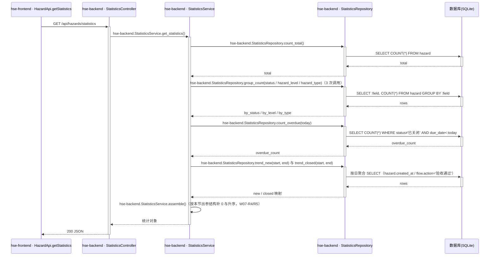

## Step 5: 功能模块与接口详细设计 - 统计模块

### 4.5 统计模块

**模块职责**：对隐患数据进行只读聚合统计，输出看板所需的计数、分布与趋势。
**覆盖功能点**：F08、F12。
**依赖模块/接口**：公共基础模块（统一异常）；只读访问 4.4.1 定义的 hazard / hazard_flow_record 表。

#### 4.5.1 表结构设计

本模块无专属表结构，原因：统计为只读聚合，复用隐患管理模块两张表（4.4.1），不落任何统计结果表（F4-R1 要求实时计算不缓存）。

#### 4.5.2 枚举与常量定义

本模块无新增枚举；统计维度取值复用 4.4.1.3 的 HazardStatus/HazardLevel/HazardType；趋势窗口常量=近 7 个自然日（含当日）。

#### 4.5.3 仓储层设计

| 归属应用 | 仓储类 | 方法名 | 关联实体/表 | 操作类型 | 核心查询/更新条件 | 入参 | 返回值 | 说明 |
|---|---|---|---|---|---|---|---|---|
| hse-backend | StatisticsRepository | count_total | hazard | 查询 | COUNT(*) | 无 | int | total |
| hse-backend | StatisticsRepository | group_count | hazard | 查询 | GROUP BY :field（status/hazard_level/hazard_type 白名单字段） | field | dict[str, int] | by_status/by_level/by_type |
| hse-backend | StatisticsRepository | count_overdue | hazard | 查询 | status≠'已关闭' AND due_date<:today | today | int | overdue_count（F4-R2） |
| hse-backend | StatisticsRepository | trend_new | hazard | 查询 | date(created_at) 在窗口内 GROUP BY date(created_at) | start_date, end_date | dict[date, int] | 趋势·新增 |
| hse-backend | StatisticsRepository | trend_closed | hazard_flow_record | 查询 | action='验收通过' AND date(created_at) 在窗口内 GROUP BY date(created_at) | start_date, end_date | dict[date, int] | 趋势·关闭（A4 口径） |

#### 4.5.4 接口设计

| 接口编号 | 接口名称 | 类型 | 方法 | 路径 | 对应功能点 |
|---|---|---|---|---|---|
| W07 | 隐患统计查询 | oneapi | GET | /api/hazards/statistics | F08/F12 |

##### 4.5.4.1 W07 隐患统计查询（F08/F12）

- **URI**：GET /api/hazards/statistics
- **接口类型**：oneapi
- **描述**：一次返回看板全部统计：总数、超期数、状态/等级/类型分布、近 7 日新增/关闭趋势。
- **入参**：无（无查询参数；趋势窗口固定为含当日的近 7 个自然日）。
- **出参**：

| 参数名称 | 类型 | 描述 |
|---|---|---|
| total | int | 隐患总数 |
| overdue_count | int | 超期未关闭数（status≠已关闭 且 due_date<今日，F4-R2） |
| by_status | object | 待审核/整改中/待验收/已关闭 计数（缺失维度补 0） |
| by_level | object | 一般/较大/重大 计数（补 0） |
| by_type | object | 6 类计数（补 0） |
| trend | array | 7 个元素：{date, new, closed}，按日期升序，无数据补 0 |

- **错误码**：

| 错误码 | 说明 |
|---|---|
| 500 | 数据库访问异常，前端卡片置「—」并图表空态（F4-R3） |

- **业务规则**：

| 规则编号 | 规则描述 | 校验时机 | 不满足时的处理 |
|---|---|---|---|
| W07-R1 | 实时聚合计算，不缓存（F4-R1） | — | — |
| W07-R2 | 超期口径 status≠已关闭 且 due_date<今日（F4-R2） | 查询 | — |
| W07-R3 | 「关闭」按 hazard_flow_record.action=验收通过 的 created_at 日期聚合（A4） | 查询 | — |
| W07-R4 | 分布字典按枚举全量输出（计数为 0 的维度也返回），保证前端渲染稳定 | 组装 | — |
| W07-R5 | 趋势窗口=含当日的近 7 个自然日，日期升序补 0 | 组装 | — |

- **处理时序图**：

- **异常场景**：

| 异常场景 | 处理方式 |
|---|---|
| DB 异常/文件占用 | 500「加载失败，请稍后重试」；前端卡片「—」+ 图表空态 + 重试（F4-R3） |
| 枚举出现脏值（绕过接口写入） | group_count 仅按白名单字段聚合，输出按枚举全量补 0（W07-R4） |

- **事务与并发控制**：只读接口、多条独立 SELECT（演示并发极低且各计数间无强一致要求）；无并发风险。
- **响应示例**：与 PRD 3.4 统计接口示例一致（total=15、overdue_count=2、by_status 待审核1/整改中4/待验收3/已关闭7、by_level 8/5/2、by_type 4/3/3/2/2/1、trend 7 项）；种子契约基准见 4.3.5。

#### 4.5.5 模块自检

**功能点—接口对账表**

| F 编号 | 功能点名称 | 对应接口章节 | 时序图 | 业务规则表 | 异常场景 | 并发控制 | 状态 |
|---|---|---|---|---|---|---|---|
| F08 | 统计看板数据 | 4.5.4.1（W07） | 有 | 有 | 有 | 无需（只读） | ✅通过 |
| F12 | 超期统计 | 4.5.4.1（W07 overdue_count，W07-R2） | 有 | 有 | 引用 | 无需（只读） | ✅通过 |

- **表结构对账**：无专属实体（4.5.1 已说明），复用表已定义 → 通过。
- **接口对账**：W07 完整（入参无/出参表/错误码/规则/时序/异常/并发/示例引用种子契约）→ 通过。
- **仓储层对账**：时序图中 count_total/group_count/count_overdue/trend_new/trend_closed 均已定义 → 通过。
- **时序图归属对账**：全部分层调用带 hse-backend 前缀 → 通过。
- **状态机对账**：本模块无含状态字段的实体 → 不适用。
- **过度设计检查**：不落统计结果表、不引入缓存（F4-R1 明确不缓存）→ 通过。
